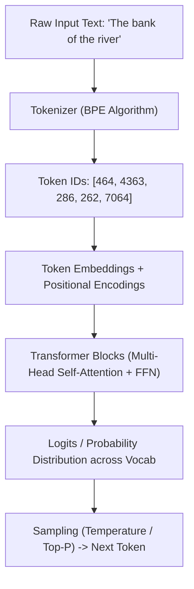

## TL;DR
- **Tokenization:** LLM raw text नहीं पढ़ते; वे text को 3-4 अक्षर के chunks (**tokens**) में तोड़ते हैं और उन्हें numeric IDs देते हैं [1]।
- **Transformer Architecture:** RNNs के sequential लूप्स के बजाय, Transformers पूरे वाक्य को एक साथ प्रोसेस करते हैं और **Self-Attention** से शब्दों के आपसी संदर्भ (context) की गणना करते हैं [1]।
- **Training Pipeline:** 2 चरणों में होता है: विशाल raw internet text पर **Pre-training** (Next-token prediction) और उसके बाद **Instruction Fine-Tuning** (SFT/RLHF/DPO) ताकि मॉडल इंसानों के आदेशों का सुरक्षित जवाब दे सके [2, 5]।
- **Inference Reality:** LLMs "सोचते" नहीं हैं; वे पिछले सभी tokens के आधार पर अगले सबसे संभावित token की probability distribution निकालकर एक-एक token generate करते हैं।

---

## Why It Matters
ChatGPT, Gemini, और Claude जैसे आधुनिक टूल्स सिर्फ जादू नहीं, बल्कि statistical pattern matching और matrix math हैं। जब आप यह समझ जाते हैं कि LLMs tokens कैसे predict करते हैं और context window की क्या सीमाएं हैं, तब आप hallucinations को पहचान पाते हैं, बेहतर prompts लिख पाते हैं, और reliable AI-powered applications build कर पाते हैं।

---

## Theory & Core Concepts

### 1. Tokenization: Text से Numbers तक
Computers text नहीं समझते, केवल numbers समझते हैं। Tokenization वह process है जिससे text को छोटे-छोटे टुकड़ों (subwords) में काटा जाता है:
- **Analogy:** जैसे अंग्रेज़ी सीखने वाला बच्चा बड़े शब्द को syllable में तोड़ता है (उदा. `un-break-able`), वैसे ही LLM Byte-Pair Encoding (BPE) अल्गोरिदम से शब्दों को tokens में बांटता है।
- **Rough Rule:** अंग्रेज़ी में 1 token ≈ 0.75 words (या लगभग 4 characters)। हिंदी और गैर-लैटिन लिपियों में एक शब्द कई tokens ले सकता है क्योंकि byte-level encodings ज़्यादा fragments में टूटती हैं।

```python
# Concept: Text to Token IDs
# 'Knowledge Hub' -> [39178, 12844]
# Model processes integer vectors, not string characters.
```

### 2. Embeddings और Positional Encoding
हर token ID को एक high-dimensional dense vector (उदा. 4096 dimensions) में map किया जाता है जिसे **Embedding** कहते हैं।
- चूंकि Transformers में RNN की तरह sequential order नहीं होता, इसलिए शब्दों की क्रमबद्धता (word order) बताने के लिए embeddings में **Positional Encodings** (Sine/Cosine waves या RoPE - Rotary Position Embeddings) जोड़ दी जाती हैं [1]।

### 3. Self-Attention: जादू का असली केंद्र
Self-Attention वह गणितीय तंत्र है जिससे हर शब्द यह तय करता है कि वाक्य के बाकी शब्दों पर कितना "ध्यान" (attention weight) देना है।
- **Formula:**
  $$\text{Attention}(Q, K, V) = \text{softmax}\left(\frac{QK^T}{\sqrt{d_k}}\right)V$$
- **Analogy (Library Filing):**
  - **Query ($Q$):** जो जानकारी आप ढूंढ रहे हैं ("मुझे Python सीखना है")।
  - **Key ($K$):** लाइब्रेरी की किताबों के लेबल ("Python 101", "Cookbook")।
  - **Value ($V$):** किताब के अंदर का असली ज्ञान।
  - जब Query और Key का dot product ज़्यादा आता है, तो उस Value को ज़्यादा weight मिलता है।



### 4. Training Pipeline: Raw Data से ChatGPT तक
1. **Pre-training:** खरबों tokens (Wikipedia, GitHub, Common Crawl) पर self-supervised learning। टास्क: *अगला शब्द क्या होगा?* [2]। इसमें लाखों डॉलर के GPU clusters (H100/B200) लगते हैं।
2. **Supervised Fine-Tuning (SFT):** इंसानों द्वारा लिखे गए high-quality Prompt-Response pairs पर मॉडल को प्रशिक्षित करना।
3. **Alignment (RLHF / DPO):** Reinforcement Learning from Human Feedback (या Direct Preference Optimization) द्वारा मॉडल को helpful, honest, और harmless बनाना [5]।

---

## Roadmap

| Step | Focus Area | Time | Prerequisite | Practice Task | Resource |
| :--- | :--- | :--- | :--- | :--- | :--- |
| **01** | Python & PyTorch basics | 2 Weeks | Basic programming | Write simple tensor multiplications | PyTorch Official 60-min Blitz |
| **02** | Tokenization & Embeddings | 1 Week | PyTorch basics | Build simple BPE tokenizer with `tiktoken` | Karpathy `minbpe` repo |
| **03** | Self-Attention from scratch | 2 Weeks | Linear algebra | Implement Scaled Dot-Product Attention in Python | 3Blue1Brown Chapter 6 |
| **04** | Decoder-Only Transformer | 3 Weeks | Attention mechanisms | Code a miniature GPT on Shakespeare dataset | Karpathy's "Let's build GPT" |
| **05** | Fine-Tuning & Quantization | 2 Weeks | Hugging Face basics | Fine-tune Llama 3 8B using LoRA on Google Colab | Hugging Face PEFT docs |

---

## Hands-on: Minimal Self-Attention Calculation

Python और PyTorch में Scaled Dot-Product Attention का मूलभूत कोड:

```python
import torch
import torch.nn.functional as F

# 1. Dummy dimensions: batch=1, seq_len=3 tokens, embed_dim=4
torch.manual_seed(42)
Q = torch.randn(1, 3, 4)
K = torch.randn(1, 3, 4)
V = torch.randn(1, 3, 4)

# 2. Scaled Dot-Product Attention
d_k = K.size(-1)
scores = torch.matmul(Q, K.transpose(-2, -1)) / (d_k ** 0.5)

# 3. Softmax to obtain probabilities (weights sum to 1)
weights = F.softmax(scores, dim=-1)

# 4. Weighted sum of values
output = torch.matmul(weights, V)
print("Output shape:", output.shape)  # torch.Size([1, 3, 4])
```

---

## Curated Resources

### 🎥 Videos
- **[Intro to Large Language Models](https://www.youtube.com/watch?v=zjkBMFhNj_g)** by Andrej Karpathy (1 hr, English, Free) — LLM fundamentals का सबसे सटीक और आसान visual breakdown [2]।
- **[Introduction to Transformers in Hindi](https://www.youtube.com/watch?v=BjRVS2wTtcA)** by CampusX (45 mins, Hindi, Free) — हिंदी में Transformer architecture की चरणबद्ध व्याख्या।
- **[Attention in transformers, step-by-step](https://www.youtube.com/watch?v=eMlx5fFNoYc)** by 3Blue1Brown (26 mins, English, Free) — Matrices और Attention का खूबसूरत 3D एनिमेशन [4]।

### 📄 Documentation & Books
- **[Hugging Face Transformers Documentation](https://huggingface.co/docs/transformers)** — Open-source ecosystem का मानक documentation।
- **[Build a Large Language Model (From Scratch)](https://www.manning.com/books/build-a-large-language-model-from-scratch)** by Sebastian Raschka — Scratch से PyTorch में LLM बनाने की व्यावहारिक किताब।

---

## Common Mistakes & Myths

| Myth / गलतफहमी | Reality / हकीकत |
| :--- | :--- |
| **"LLM डेटाबेस की तरह सर्च करता है"** | LLM कोई search engine नहीं है। यह parameters (weights) में stored compressed statistical patterns से text synthesize करता है। |
| **"LLM logical thinking करता है"** | मॉडल token probabilities calculate करता है। अगर intermediate reasoning steps (Chain-of-Thought) न दिए जाएं, तो यह complex math में fail हो जाता है। |
| **"Temperature 0 मतलब 100% सही जवाब"** | Temperature 0 का मतलब केवल greedy decoding (सबसे high probability token चुनना) है; अगर मॉडल के weights में गलत जानकारी है, तो वह पूरे आत्मविश्वास से गलत जवाब ही देगा। |

---

## Frequently Asked Questions (FAQ)

### Q1: Hallucination क्यों होती है?
**Ans:** Pre-training का objective "सत्य बोलना" नहीं, बल्कि "वाक्य में अगला सबसे संभावित token predict करना" है। जब context अस्पष्ट होता है, मॉडल व्याकरण के अनुसार सही दिखने वाला लेकिन काल्पनिक तथ्य गढ़ देता है।

### Q2: Context Window क्या है और यह क्यों सीमित होती है?
**Ans:** Attention mechanism की compute complexity $O(N^2)$ होती है (जहाँ $N$ tokens की संख्या है)। यद्यपि FlashAttention और RoPE ने context window को 128k-1M tokens तक बढ़ाया है, GPU VRAM और "Lost in the Middle" समस्या के कारण अत्यधिक context में retrieval accuracy घटती है।

### Q3: Temperature और Top-P में क्या अंतर है?
**Ans:** **Temperature** probability distribution की sharpness को नियंत्रित करता है (कम value = predictable, उच्च value = creative)। **Top-P (Nucleus Sampling)** केवल उन सबसे ऊपरी tokens को चुनता है जिनका cumulative probability sum threshold $P$ तक पहुँचता है।

---

## Related Topics
- [ai-agents-and-rag](/knowledge-hub/topics/ai-agents-and-rag/) — LLMs को external memory और real-time data से जोड़ने की तकनीक।
- [prompt-engineering-students](/knowledge-hub/topics/prompt-engineering-students/) — Models से सटीक और structured परिणाम प्राप्त करने की कला।

---

## Sources & References
- [1] Vaswani, A., et al. (2017). *Attention Is All You Need*. arXiv:1706.03762. [https://arxiv.org/abs/1706.03762](https://arxiv.org/abs/1706.03762)
- [2] Karpathy, A. (2023). *Intro to Large Language Models*. YouTube Talk. [https://www.youtube.com/watch?v=zjkBMFhNj_g](https://www.youtube.com/watch?v=zjkBMFhNj_g)
- [3] Hugging Face NLP Course (2024). *The Transformer Architecture*. [https://huggingface.co/learn/nlp-course](https://huggingface.co/learn/nlp-course)
- [4] Sanderson, G. / 3Blue1Brown (2024). *Attention in transformers, step-by-step*. [https://www.youtube.com/watch?v=eMlx5fFNoYc](https://www.youtube.com/watch?v=eMlx5fFNoYc)
- [5] Rafailov, R., et al. (2023). *Direct Preference Optimization: Your Language Model is Secretly a Reward Model*. NeurIPS. arXiv:2305.18290. [https://arxiv.org/abs/2305.18290](https://arxiv.org/abs/2305.18290)
