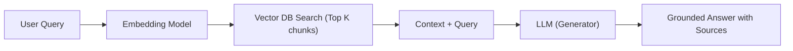
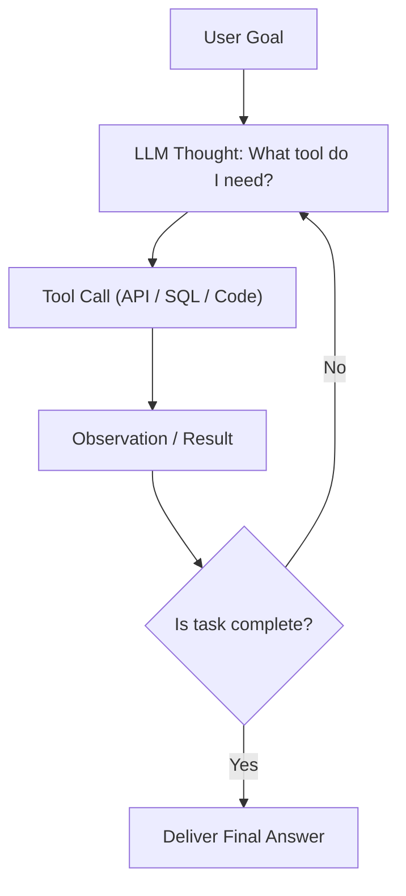

## TL;DR
- **RAG (Knowledge Augmentation):** आपके private documents या internal database से relevant text chunks retrieve करके LLM के prompt में inject करता है [1]। यह static question-answering के लिए fast, cheap, और highly deterministic है।
- **AI Agents (Action & Tool Use):** एक dynamic loop (ReAct pattern) चलाते हैं जहाँ LLM तय करता है कि *क्या सोचना है*, *कौन सा tool call करना है* (Calculator, Web Search, Code Runner), और output के आधार पर अगला कदम क्या होगा [2]।
- **The Golden Rule:** अगर सवाल का जवाब केवल दस्तावेज़ पढ़कर दिया जा सकता है, तो **RAG** चुनें। अगर कार्य में multi-step planning, state changes, external APIs या conditionals शामिल हैं, तो **Agent** चुनें।
- **Cost & Latency:** RAG 1 round-trip में पूरा होता है (Latency < 1-2s); Agentic loops में कई LLM calls होती हैं (Latency 5-20s, cost 3x-10x ज़्यादा)।

---

## Why It Matters
AI landscape में 2024-2026 का सबसे बड़ा बदलाव "Prompt Wrappers" से "Autonomous Systems" की ओर रहा है। फ्रेशर्स और डेवलपर्स अक्सर simple query के लिए heavy agents बनाकर latency और cost बढ़ा लेते हैं, या multi-step problems को basic RAG से हल करने की कोशिश में fail हो जाते हैं। दोनों के trade-offs और integration को समझना modern engineering की सबसे कीमती skill है।

---

## Theory & Core Concepts

### 1. RAG (Retrieval-Augmented Generation) कैसे काम करता है
RAG मॉडल के weights को फिर से train किए बिना उसे external data का access देता है [1]:
1. **Indexing:** Documents को छोटे-छोटे Chunks (उदा. 512 tokens) में तोड़ा जाता है और Embedding Model (जैसे `text-embedding-3-small`) से vector space में convert करके Vector Database (Pinecone, Chroma, Qdrant) में store किया जाता है।
2. **Retrieval:** User query को embed किया जाता है और Cosine Similarity / Hybrid Search (BM25 + Dense) द्वारा top-$k$ सबसे मिलते-जुलते chunks निकाले जाते हैं।
3. **Generation:** LLM को system prompt दिया जाता है: *"केवल नीचे दिए गए Context के आधार पर उत्तर दें..."*



### 2. AI Agents: The ReAct Loop (Reasoning + Acting)
Agents केवल जवाब नहीं देते; वे autonomous decisions लेते हैं [2]:
- **Thought:** LLM विचार करता है कि user का अंतिम लक्ष्य क्या है और अगला missing piece क्या है।
- **Action:** LLM एक tool call करता है (e.g. `google_search("current weather Delhi")` या `sql_query(...)`)।
- **Observation:** Tool से output वापस LLM को मिलता है।
- **Loop Termination:** जब लक्ष्य पूरा हो जाता है, agent `Final Answer` लौटाता है।



### 3. Comparison Matrix: RAG vs AI Agents

| Parameter | Standard RAG | Autonomous Agent | Hybrid (Agentic RAG) |
| :--- | :--- | :--- | :--- |
| **Primary Purpose** | Information Retrieval & Summarization | Multi-step problem solving & Actions | Complex research across diverse databases |
| **Control Flow** | Linear, Deterministic ($1 \times$ call) | Cyclic, Non-deterministic (1 to $N$ steps) | Controlled agentic routing with fallback |
| **Average Latency** | 500ms – 2s | 3s – 30s | 2s – 8s |
| **API Cost** | Low (Single LLM invocation) | High (Multiple tokens across iterations) | Moderate |
| **Failure Mode** | Irrelevant retrieval (semantic drift) | Infinite loops, wrong tool parameters | Retrieval re-ranking failures |

---

## Roadmap

| Step | Focus Area | Time | Prerequisite | Practice Task | Resource |
| :--- | :--- | :--- | :--- | :--- | :--- |
| **01** | Vector Embeddings & Similarity | 1 Week | Python basics | Calculate cosine similarity between sentences | Hugging Face MTEB leaderboard |
| **02** | Simple RAG Pipeline | 1.5 Weeks | OpenAI / Ollama APIs | Build a "Chat with PDF" using ChromaDB | CampusX RAG Hindi Video |
| **03** | Advanced RAG Techniques | 2 Weeks | RAG basics | Add Reciprocal Rank Fusion (RRF) & Cohere Rerank | LlamaIndex Advanced RAG docs |
| **04** | Function Calling & Tool Use | 1.5 Weeks | LLM APIs | Write a weather agent using OpenAI Tools API | OpenAI Function Calling Guide |
| **05** | Agentic Workflows & LangGraph | 2 Weeks | Python OOP | Build a multi-agent debate/researcher system | LangGraph Official Tutorials |

---

## Hands-on: Building a Minimal ReAct Agent in Python

बिना किसी भारी framework के vanilla Python और OpenAI API के साथ tool-calling agent:

```python
import json

# Minimal ReAct Tool definition schema
tools = [
    {
        "type": "function",
        "function": {
            "name": "calculate_tax",
            "description": "Calculate income tax under Indian New Tax Regime FY 2024-25",
            "parameters": {
                "type": "object",
                "properties": {
                    "income": {"type": "number", "description": "Annual taxable income in INR"}
                },
                "required": ["income"]
            }
        }
    }
]

def execute_tool(name, args):
    if name == "calculate_tax":
        inc = args["income"]
        # Simplified New Regime: Up to 3L nil, 3-7L 5%, 7-10L 10%
        if inc <= 700000:
            return "Tax is 0 (Full rebate under Section 87A)"
        return f"Approx tax on {inc} calculated via slab matrix"
    return "Unknown tool"

# In production, send `tools` to LLM.
# When LLM returns `tool_calls`, run execute_tool() and pass observation back!
```

---

## Curated Resources

### 🎥 Videos
- **[Retrieval Augmented Generation (RAG) Explained](https://www.youtube.com/watch?v=X0btK9X0Xnk)** by CampusX (40 mins, Hindi, Free) — Vector search और LangChain RAG pipeline का संपूर्ण हिंदी ट्यूटोरियल।
- **[What are AI Agents?](https://www.youtube.com/watch?v=F8NKVhkZZWI)** by IBM Technology (12 mins, English, Free) — Agentic systems, tool integrations और enterprise use cases।

### 📄 Documentation & Frameworks
- **[LangChain Agents Documentation](https://python.langchain.com/docs/concepts/agents/)** — Agent architectures, tool calling standards, और memory patterns [3]।
- **[LlamaIndex Concepts](https://docs.llamaindex.ai/en/stable/getting_started/concepts/)** — Data ingestion, indexing strategies, और production evaluation (Ragas) [4]।

---

## Common Mistakes & Myths

| Myth / गलतफहमी | Reality / हकीकत |
| :--- | :--- |
| **"RAG का मतलब हमेशा Vector Database होता है"** | गलत। अगर डेटा structured है, तो Text-to-SQL या Elasticsearch BM25 vector DB से कहीं तेज़ और सटीक परिणाम देते हैं। |
| **"Agent को पूरी छूट दे देनी चाहिए"** | Autonomous agents production में infinite loop में फंस सकते हैं या भारी API bills बना सकते हैं। हमेशा `max_iterations`, timeouts, और Human-in-the-Loop constraints लगाएं। |
| **"Fine-tuning RAG से बेहतर है"** | Fine-tuning मॉडल का style/tone बदलने के लिए होती है, dynamic knowledge देने के लिए नहीं। Knowledge retention और citation के लिए RAG हमेशा superior है। |

---

## Frequently Asked Questions (FAQ)

### Q1: Agentic RAG क्या होता है?
**Ans:** पारम्परिक RAG एक बार सर्च करता है। **Agentic RAG** में LLM खुद जांचता है कि "क्या retrieve किए गए दस्तावेज़ों से उत्तर मिल सकता है?" अगर नहीं, तो वह query rewrite करता है या दूसरे database से जानकारी खोजता है (Self-Reflective RAG)।

### Q2: Chunk Size कैसे तय करें?
**Ans:** सामान्यतः 256 से 512 tokens का chunk size और 10-20% overlap आदर्श माना जाता है। बहुत बड़ा chunk semantic clarity घटाता है, जबकि बहुत छोटा chunk context तोड़ देता है।

---

## Related Topics
- [llms-how-they-work](/knowledge-hub/topics/llms-how-they-work/) — LLM inference और tokenization के मूल सिद्धांत।
- [prompt-engineering-students](/knowledge-hub/topics/prompt-engineering-students/) — Structured system prompts और function schemas तैयार करना।

---

## Sources & References
- [1] Lewis, P., et al. (2020). *Retrieval-Augmented Generation for Knowledge-Intensive NLP Tasks*. NeurIPS. arXiv:2005.11401. [https://arxiv.org/abs/2005.11401](https://arxiv.org/abs/2005.11401)
- [2] Yao, S., et al. (2022). *ReAct: Synergizing Reasoning and Acting in Language Models*. ICLR. arXiv:2210.03629. [https://arxiv.org/abs/2210.03629](https://arxiv.org/abs/2210.03629)
- [3] LangChain Documentation (2024). *Concepts: Agents and Tool Calling*. [https://python.langchain.com/docs/concepts/agents/](https://python.langchain.com/docs/concepts/agents/)
- [4] LlamaIndex Documentation (2024). *Production RAG & Data Framework*. [https://docs.llamaindex.ai/en/stable/](https://docs.llamaindex.ai/en/stable/)
