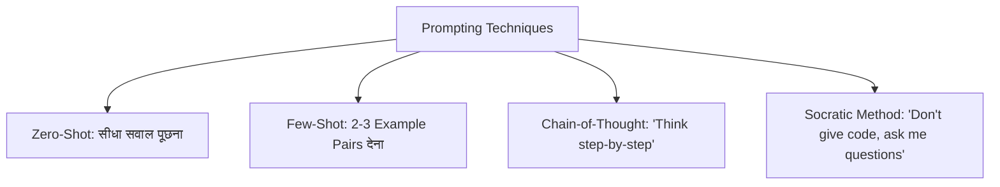

## TL;DR
- **The Core Formula:** बेहतरीन prompts का एक ढांचा होता है: **Role + Context + Clear Task + Strict Constraints + Output Format** [1]।
- **Chain-of-Thought (CoT):** जब आप AI को *"कदम दर कदम सोचो (Think step by step)"* कहते हैं, तो गणितीय और तार्किक सटीकता 40-70% तक बढ़ जाती है [2]।
- **Few-Shot Examples:** केवल नियम समझाने के बजाय 2-3 इनपुट-आउटपुट उदाहरण देने से मॉडल आपकी इच्छित शैली पकड़ लेता है।
- **Student Ethics:** AI को "सॉल्व करने वाली मशीन" के रूप में इस्तेमाल न करें; इसे **"पर्सनल ट्यूटर"** (Socratic Mentor) बनाएं जो आपको सवाल पूछे और कमियों को उजागर करे।

---

## Why It Matters
अधिकांश छात्र ChatGPT या Gemini में केवल एक पंक्ति लिखते हैं: *"Write an essay on Operating Systems"* या *"Fix my code"* — और फिर घटिया या काल्पनिक जवाब मिलने पर निराश होते हैं। Prompt Engineering कोई कोडिंग नहीं, बल्कि AI से बात करने की स्पष्ट और संरचित भाषा है। इस कौशल से आपका रिसर्च समय 75% घट सकता है और आपकी समझ कई गुना गहरी हो सकती है।

---

## Theory & Core Concepts

### 1. The R-C-T-C-F Framework (मास्टर प्रॉम्प्ट स्ट्रक्चर)
हर प्रभावी प्रॉम्प्ट में ये 5 हिस्से होने चाहिए [1]:
1. **Role (भूमिका):** *"तुम एक FAANG Senior Software Architect हो..."*
2. **Context (पृष्ठभूमि):** *"मैं Tier-3 कॉलेज का 3rd year स्टूडेंट हूँ और Java में OS concepts पढ़ रहा हूँ..."*
3. **Task (कार्य):** *"मुझे Deadlock के 4 Coffman conditions समझाओ..."*
4. **Constraints (सीमाएं):** *"कोई अकादमिक किताबी परिभाषा मत दो; वास्तविक जीवन की analogy और 100 शब्दों से कम में समझाओ..."*
5. **Format (प्रारूप):** *"Bullet points और Markdown table में आउटपुट दो..."*

### 2. Prompting Techniques



#### Technique Comparison:
- **Zero-Shot:** सीधे सवाल पूछना। (उदा. *"Python में reverse string का फंक्शन लिखो"*).
- **Few-Shot:** जब फॉर्मेट कड़ा हो, तो उदाहरण दें [1]:
  ```
  Input: "Good job!" -> Sentiment: Positive
  Input: "The battery dies in 1 hour." -> Sentiment: Negative
  Input: "The color is blue." -> Sentiment: Neutral
  Input: "Delivery was 3 days late." -> Sentiment: 
  ```
- **Chain-of-Thought (CoT):** गणितीय या लॉजिकल समस्याओं के लिए यह जादुई तकनीक है। Wei et al. (2022) के अनुसार, मॉडल को अपने विचार व्यक्त करने की जगह देने से गलतियों की संभावना न्यूनतम हो जाती है [2]।

### 3. Students के लिए Socratic Prompt Template
असाइनमेंट में सीधे कॉपी करने के बजाय इसे प्रॉम्प्ट दें:

> *"तुम मेरे पर्सनल DSA मेंटर हो। मुझे सीधे कोड का समाधान मत दो। जब मैं तुम्हें कोई समस्या दूँ, तो मुझसे 1-2 प्रश्न पूछकर मेरा मार्गदर्शन करो कि कौन सा Data Structure उपयुक्त होगा। जब मैं सही जवाब दूँ तभी आगे बढ़ो।"*

---

## Roadmap

| Step | Technique | Time | Focus | Practice Exercise |
| :--- | :--- | :--- | :--- | :--- |
| **01** | Basic Prompt Anatomy | 2 Days | Role & Constraints | Rewrite 5 vague questions into RCTCF format |
| **02** | Few-Shot Prompting | 3 Days | Formatting & Schemas | Build a prompt that parses messy raw notes into JSON |
| **03** | Chain-of-Thought (CoT) | 4 Days | Logic & Math reasoning | Solve 10 LeetCode Medium word problems step-by-step |
| **04** | Socratic Tutoring | 3 Days | Learning retention | Use Claude/ChatGPT to quiz you on OS Deadlocks |
| **05** | Hallucination Prevention | 2 Days | Fact-checking | Prompt AI to cite exact documentation links & challenge it |

---

## Hands-on: Clean Debugging Prompt

जब आपका कोड काम न कर रहा हो, तो यह प्रॉम्प्ट टेम्पलेट इस्तेमाल करें:

```markdown
Role: Senior Staff Engineer in Python.
Context: I am working on a Flask REST API connected to SQLite.
Problem: When calling `GET /users`, I get a 500 Internal Server Error with `sqlite3.OperationalError: database is locked`.

Code Snippet:
```python
@app.route('/users')
def get_users():
    conn = sqlite3.connect('app.db')
    cursor = conn.cursor()
    users = cursor.execute("SELECT * FROM users").fetchall()
    return jsonify(users)
```

Task:
1. Explain in 2 sentences WHY this error happens in multi-threaded Flask.
2. Provide the corrected code using best practices (connection context manager).
3. Do NOT suggest switching to PostgreSQL yet; keep it focused on SQLite concurrency.
```

---

## Curated Resources

### 🎓 Official Guides & Courses
- **[ChatGPT Prompt Engineering for Developers](https://www.deeplearning.ai/short-courses/chatgpt-prompt-engineering-for-developers/)** by Andrew Ng & Isa Fulford (1 hr, Free) — Official gold-standard course [4]।
- **[OpenAI Prompt Engineering Guide](https://platform.openai.com/docs/guides/prompt-engineering)** — Best practices, delimiter usage, system message design [1]।
- **[Anthropic Interactive Tutorial](https://docs.anthropic.com/en/docs/build-with-claude/prompt-engineering/overview)** — Claude के लिए step-by-step interactive exercises [3]।

---

## Common Mistakes & Myths

| Myth / गलतफहमी | Reality / हकीकत |
| :--- | :--- |
| **"जितना लंबा प्रॉम्प्ट, उतना अच्छा जवाब"** | अनावश्यक शब्दों से LLM का "Lost in the Middle" bias बढ़ता है। प्रॉम्प्ट concise और laser-focused होना चाहिए। |
| **"AI हर रिसर्च पेपर का असली लिंक दे सकता है"** | LLM URLs और citations को बहुत आसानी से fabricate (hallucinate) करते हैं। हमेशा paper title को Google Scholar या arXiv पर स्वयं verify करें। |
| **"AI से असाइनमेंट लिखवाना स्मार्टनेस है"** | इंटरव्यू में जब बुनियादी सवाल पूछे जाते हैं, तो बिना समझ के सबमिट करने वाले छात्र तुरंत पकड़े जाते हैं। AI को समझने के लिए इस्तेमाल करें, नकल के लिए नहीं। |

---

## Frequently Asked Questions (FAQ)

### Q1: System Prompt और User Prompt में क्या अंतर है?
**Ans:** **System Prompt** मॉडल की मूल पहचान, नियम और व्यवहार की सीमाएं तय करता है (यह स्थायी रहता है)। **User Prompt** वह तात्कालिक इनपुट या सवाल है जो उपयोगकर्ता बातचीत में भेजता है।

### Q2: Delimiters (`"""`, `###`, XML tags) क्यों इस्तेमाल करने चाहिए?
**Ans:** Delimiters LLM को स्पष्ट बताते हैं कि कौन सा हिस्सा निर्देश (instructions) है और कौन सा हिस्सा डेटा (context/text) है। इससे Prompt Injection का खतरा घटता है।

---

## Related Topics
- [llms-how-they-work](/knowledge-hub/topics/llms-how-they-work/) — Tokens और Attention के आधार पर प्रॉम्प्ट्स का काम करना।
- [placement-offcampus-playbook](/knowledge-hub/topics/placement-offcampus-playbook/) — AI से Resume और Mock Interviews की तैयारी करना।

---

## Sources & References
- [1] OpenAI (2024). *Prompt Engineering Guide*. [https://platform.openai.com/docs/guides/prompt-engineering](https://platform.openai.com/docs/guides/prompt-engineering)
- [2] Wei, J., et al. (2022). *Chain-of-Thought Prompting Elicits Reasoning in Large Language Models*. NeurIPS. arXiv:2201.11903. [https://arxiv.org/abs/2201.11903](https://arxiv.org/abs/2201.11903)
- [3] Anthropic Documentation (2024). *Prompt Engineering Interactive Tutorial*. [https://docs.anthropic.com/en/docs/build-with-claude/prompt-engineering/overview](https://docs.anthropic.com/en/docs/build-with-claude/prompt-engineering/overview)
- [4] Ng, A. & Fulford, I. (2023). *ChatGPT Prompt Engineering for Developers*. DeepLearning.AI. [https://www.deeplearning.ai/short-courses/chatgpt-prompt-engineering-for-developers/](https://www.deeplearning.ai/short-courses/chatgpt-prompt-engineering-for-developers/)
