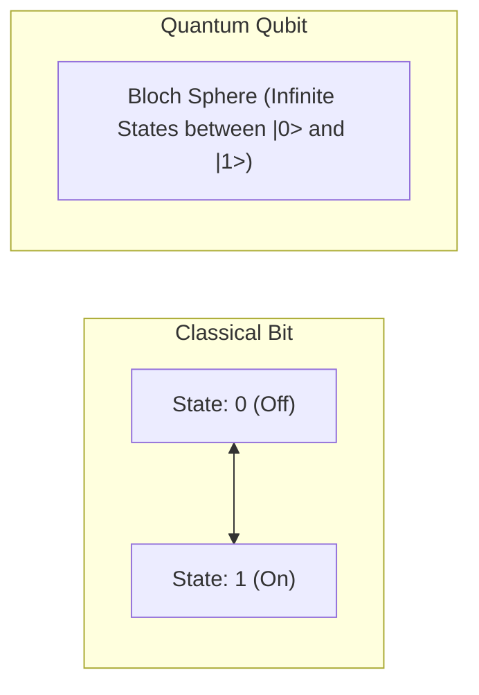
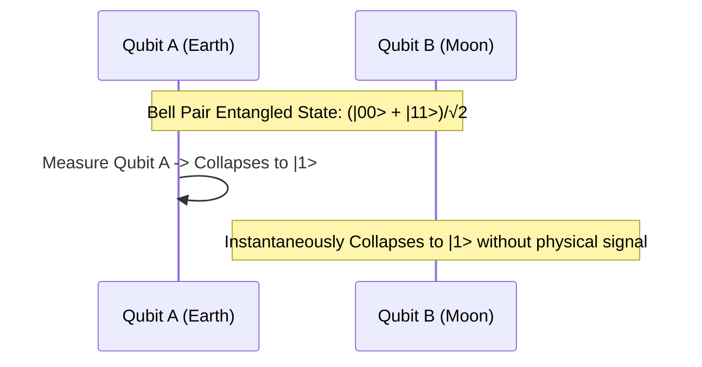

## TL;DR
- **Classical Bit vs Qubit:** एक सामान्य बिट या तो 0 होता है या 1 (जैसे एक लाइट स्विच)। एक **Qubit** 0 और 1 दोनों की सम्भावनाओं के मिश्रण में रह सकता है [1]।
- **Superposition:** मेज पर रखा सिक्का 'Heads' या 'Tails' होता है, लेकिन घूमता हुआ सिक्का (spinning coin) दोनों अवस्थाओं का मिश्रण है जब तक आप उसे रोक न दें।
- **Measurement Collapse:** जैसे ही आप क्वांटम सिस्टम को मापते (observe) हैं, उसकी सुपरपोजिशन तुरंत खत्म हो जाती है और वह सामान्य 0 या 1 में बदल जाता है [1]।
- **Entanglement:** दो या अधिक क्यूबिट्स का आपस में ऐसा गहरा जुड़ाव कि एक की स्थिति जानते ही दूसरे की स्थिति ब्रह्मांड के किसी भी कोने में तुरंत तय हो जाती है [3]।

---

## Why It Matters
क्वांटम कंप्यूटिंग कोई "तेज़ लैपटॉप" नहीं है जो YouTube तेज़ी से चलाएगा। यह कंप्यूटेशन का बिल्कुल नया भौतिक प्रतिमान (physical paradigm) है। जहाँ एक सामान्य कंप्यूटर को लाखों साल लग सकते हैं (जैसे molecular simulation, battery chemistry, या cryptographic factorization), वहाँ क्वांटम अल्गोरिदम घातीय (exponential) तेज़ी ला सकते हैं। इसे समझना भविष्य के तकनीकी बदलाव की नींव है।

---

## Theory & Core Concepts

### 1. The Coin Analogy: Bit vs Qubit
- **Classical Bit:** एक सिक्का मेज पर रखा है। वह या तो **Heads (1)** है या **Tails (0)**।
- **Qubit in Superposition:** सिक्के को मेज पर तेज़ी से घुमाएं। जब सिक्का घूम रहा होता है, तो क्या वह केवल Heads है? नहीं। क्या केवल Tails है? नहीं। वह दोनों की निरंतर सम्भावना में है।
- गणित में इसे $|\psi\rangle = \alpha|0\rangle + \beta|1\rangle$ लिखते हैं, जहाँ $|\alpha|^2$ 0 पाने की सम्भावना है और $|\beta|^2$ 1 पाने की सम्भावना है।



### 2. The Maze Problem: Parallelism की ताकत
मान लीजिए आपको एक बहुत बड़ी भूलभुलैया (maze) से बाहर निकलने का रास्ता खोजना है:
- **Classical Computer:** एक चूहे की तरह एक-एक रास्ता चलकर देखता है। दीवार आई तो वापस लौटता है और दूसरा रास्ता चुनता है।
- **Quantum Superposition:** भूलभुलैया में एक साथ पानी की धार छोड़ने जैसा है। पानी एक ही समय में सभी रास्तों पर बहता है और सही निकास तक पहुँच जाता है।
- $N$ qubits एक साथ $2^N$ अवस्थाओं (states) को समाहित कर सकते हैं। केवल 300 आदर्श qubits ब्रह्मांड के सभी परमाणुओं (atoms) से ज़्यादा संख्याओं को एक साथ दर्शा सकते हैं!

### 3. Entanglement: "Spooky Action at a Distance"
अल्बर्ट आइंस्टीन ने इसे *"दूरी पर रहस्यमयी प्रभाव"* कहा था [3]:
- **दस्ताने का डिब्बा (Glove Box Analogy):**
  - मान लीजिए आपके पास दो डिब्बे हैं। एक में बायां दस्ताना (Left glove) है और दूसरे में दायां दस्ताना (Right glove)।
  - एक डिब्बा दिल्ली में रखा जाए और दूसरा चाँद पर भेज दिया जाए।
  - जैसे ही आप दिल्ली का डिब्बा खोलते हैं और उसमें **बायां दस्ताना** निकलता है, आप उसी मिलीसेकंड में 100% जान जाते हैं कि चाँद वाले डिब्बे में **दायां दस्ताना** ही होगा — बिना चाँद जाए और बिना कोई संदेश भेजे!
  - क्वांटम दुनिया में, डिब्बा खोलने से पहले दोनों डिब्बों में दस्ताने किसी निश्चित आकार में नहीं होते; वे एंटैंगल्ड होते हैं।



### 4. Quantum Interference: सही जवाब को बड़ा करना
अगर क्यूबिट सुपरपोजिशन में है और मेजरमेंट पर रैंडम 0 या 1 मिलता है, तो क्वांटम कंप्यूटर उपयोगी कैसे हुआ?
- यहीं जादू आता है: **Quantum Interference**।
- जैसे पानी की दो लहरें मिलकर एक-दूसरे को नष्ट (destructive interference) या बड़ा (constructive interference) कर सकती हैं, वैसे ही क्वांटम एल्गोरिदम गलत उत्तरों की सम्भावना को घटाकर शून्य कर देते हैं और सही उत्तर की सम्भावना को 100% तक बढ़ा देते हैं [1]।

---

## Roadmap

| Step | Concept | Estimated Time | Practice Activity | Resource |
| :--- | :--- | :--- | :--- | :--- |
| **01** | Classical Logic vs Probabilistic Logic | 1 Week | Coin flip simulations in Python | Khan Academy Probability |
| **02** | Qubit Representation & Bloch Sphere | 1.5 Weeks | Explore 3D Bloch Sphere visualizer | IBM Quantum Composer |
| **03** | Single-Qubit Gates (X, Z, Hadamard) | 2 Weeks | Create superposition using Hadamard (H) gate | Qiskit Interactive Tutorial |
| **04** | Two-Qubit Gates & CNOT | 2 Weeks | Create a Bell State (Entanglement) | Qiskit Textbook Bell States |
| **05** | Quantum Algorithms Overview | 2 Weeks | Walk through Deutsch-Jozsa algorithm | Veritasium Quantum Video |

---

## Hands-on: Qiskit Code for Superposition & Entanglement

IBM के open-source Python SDK **Qiskit** में 2-qubit Bell State बनाना:

```python
# Install via: pip install qiskit
from qiskit import QuantumCircuit

# 1. Create a Circuit with 2 Qubits and 2 Classical Bits
qc = QuantumCircuit(2, 2)

# 2. Apply Hadamard Gate on Qubit 0 -> Enters Superposition (|0> + |1>)/sqrt(2)
qc.h(0)

# 3. Apply CNOT (Controlled-NOT) Gate with Control=0, Target=1 -> Entanglement!
qc.cx(0, 1)

# 4. Measure both qubits into classical bits
qc.measure([0, 1], [0, 1])

# Output circuit diagram
print(qc.draw(output='text'))
# Result: Measurements will yield ONLY '00' (50%) or '11' (50%), NEVER '01' or '10'!
```

---

## Curated Resources

### 🎥 Videos
- **[What makes quantum computers SO powerful?](https://www.youtube.com/watch?v=-UrdExQW0cs)** by Veritasium (24 mins, English, Free) — Qubits और Interference का दुनिया का सबसे बेहतरीन visual explainer [3]।
- **[Quantum Computing Explained in Hindi](https://www.youtube.com/watch?v=IhOC3FhY8i8)** by Geekyranjit (14 mins, Hindi, Free) — बिना भारी शब्दावली के आम भाषा में क्वांटम कंप्यूटिंग की व्याख्या।

### 📄 Documentation & Learning Portals
- **[IBM Quantum Learning Platform](https://learning.quantum.ibm.com/)** — दुनिया का सबसे व्यवस्थित free interactive quantum curriculum [2]।
- **[IBM Quantum Composer](https://quantum.ibm.com/composer)** — बिना कोड लिखे drag-and-drop से क्वांटम सर्किट बनाने का वेब टूल।

---

## Common Mistakes & Myths

| Myth / गलतफहमी | Reality / हकीकत |
| :--- | :--- |
| **"Entanglement से प्रकाश से तेज़ डेटा भेजा जा सकता है"** | गलत (No-Communication Theorem)। चूँकि दोनों छोर पर माप का परिणाम यादृच्छिक (random) होता है, इसलिए बिना किसी क्लासिकल चैनल के कोई सार्थक संदेश नहीं भेजा जा सकता। |
| **"क्वांटम कंप्यूटर पर्सनल कंप्यूटर को रिप्लेस कर देंगे"** | क्वांटम कंप्यूटरों को absolute zero (-273°C) तापमान और भारी क्रायोजेनिक शील्डिंग की आवश्यकता होती है। वे डेटा सेंटर और सुपरकंप्यूटर का हिस्सा बनेंगे, आपके फोन का नहीं। |
| **"Qubit एक साथ अनंत मान रख सकता है"** | Qubit का स्टेट स्पेस कंटीन्यूअस होता है, लेकिन मेजरमेंट करने पर वह केवल 1 बिट क्लासिकल जानकारी (0 या 1) ही देता है (Holevo's Theorem)। |

---

## Frequently Asked Questions (FAQ)

### Q1: Superposition में क्या qubit वास्तव में एक साथ दो जगह होता है?
**Ans:** यह क्वांटम वेव-फंक्शन की अवस्था है। जब तक सिस्टम को छुआ या मापा नहीं जाता, वह दोनों अवस्थाओं के एम्प्लीट्यूड (amplitudes) को सहेज कर रखता है। यह जादू नहीं, सूक्ष्म कणों का भौतिक गुण है।

### Q2: Decoherence क्या है और वैज्ञानिक इससे क्यों डरते हैं?
**Ans:** क्वांटम अवस्थाएं अत्यंत नाजुक होती हैं। थोड़ी सी गर्मी, कंपन या विद्युत-चुंबकीय तरंग भी क्यूबिट को छू ले तो वह अपनी सुपरपोजिशन खो देता है (Decoherence)। यही कारण है कि क्वांटम कंप्यूटर बनाना दुनिया की सबसे कठिन इंजीनियरिंग चुनौतियों में से एक है।

---

## Related Topics
- [quantum-roadmap-and-reality](/knowledge-hub/topics/quantum-roadmap-and-reality/) — Qiskit लर्निंग पाथ और आज के हार्डवेयर की ज़मीनी हकीकत।
- [llms-how-they-work](/knowledge-hub/topics/llms-how-they-work/) — क्लासिकल न्यूरल नेटवर्क्स और ट्रांसफॉर्मर्स की कार्यप्रणाली।

---

## Sources & References
- [1] Nielsen, M. A., & Chuang, I. L. (2010). *Quantum Computation and Quantum Information: 10th Anniversary Edition*. Cambridge University Press. [https://doi.org/10.1017/CBO9780511976667](https://doi.org/10.1017/CBO9780511976667)
- [2] IBM Quantum (2024). *Basics of Quantum Information*. [https://learning.quantum.ibm.com/](https://learning.quantum.ibm.com/)
- [3] Muller, D. / Veritasium (2023). *What makes quantum computers SO powerful?*. [https://www.youtube.com/watch?v=-UrdExQW0cs](https://www.youtube.com/watch?v=-UrdExQW0cs)
- [4] Bernhardt, C. (2019). *Quantum Computing for Everyone*. The MIT Press.
