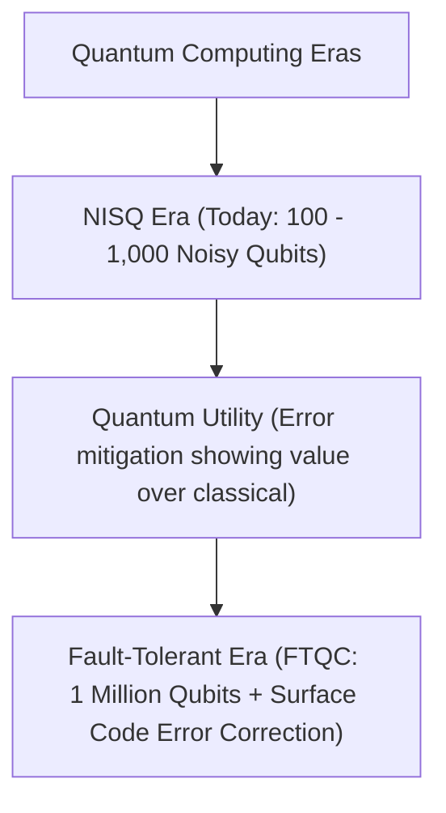

## TL;DR
- **हाइप बनाम हकीकत:** आज हम **NISQ युग** (Noisy Intermediate-Scale Quantum) में हैं [2]। आज के सिस्टम्स में शोर (noise) और एरर बहुत ज़्यादा हैं; उपयोगी गणनाओं के लिए Fault-Tolerant Quantum Computing (FTQC) की दरकार है।
- **RSA टूटने का डर:** Shor's algorithm से RSA-2048 encryption तोड़ने के लिए लाखों physical qubits की ज़रूरत होगी, जो कम से कम 2030-2035 से पहले मुमकिन नहीं दिखता। फिर भी NIST ने 2024 में Post-Quantum Cryptography (FIPS 203/204/205) जारी कर दिए हैं [3]।
- **National Quantum Mission (भारत):** अप्रैल 2023 में भारत सरकार ने ₹6,003.65 करोड़ का NQM मंज़ूर किया, जिसका लक्ष्य 2031 तक 50 से 1,000 physical qubits और 2,000 किमी की Quantum Communication लाइनें विकसित करना है [1]।
- **सीखने का रास्ता:** Qiskit 1.0+ से शुरुआत करें, बुनियादी सर्किट्स बनाएं, और सिमुलेटर पर टेस्ट करें।

---

## Why It Matters
क्वांटम कंप्यूटिंग पर इंटरनेट पर दो अतियों (extremes) में बात होती है: या तो यह कहा जाता है कि "कल सारे पासवर्ड टूट जाएंगे", या फिर "यह पूरी तरह फ्रॉड है"। एक गंभीर छात्र या इंजीनियर के लिए यह समझना ज़रूरी है कि असली विज्ञान कहाँ खड़ा है, हार्डवेयर की क्या बाधाएं हैं, और किस तरह भारत और विश्व में क्वांटम सॉफ्टवेयर इंजीनियर्स और रिसर्चर्स के लिए बड़े करियर अवसर तैयार हो रहे हैं।

---

## Theory & Core Concepts

### 1. Quantum Hardware Paradigms
क्वांटम कंप्यूटर बनाने का कोई एक तरीका नहीं है। दुनिया की अलग-अलग कंपनियाँ अलग-अलग भौतिकी अपना रही हैं:
- **Superconducting Qubits (IBM, Google):** अल्युमिनियम और जोसेफसन जंक्शन (Josephson junctions) से बने माइक्रोचिप्स, जिन्हें मिलीकेल्विन तापमान (-273°C) पर ठंडा रखना पड़ता है।
- **Trapped Ion (IonQ, Quantinuum):** लेज़र बीम के ज़रिए वैक्यूम चैंबर में चार्ज्ड आयनों को हवा में लटकाकर कंट्रोल करना। कम शोर, लेकिन गेट ऑपरेशन्स धीमे होते हैं।
- **Neutral Atoms (QuEra, Harvard):** लेज़र चिमटी (optical tweezers) से रूबिडियम या स्ट्रोंटियम परमाणुओं को नियंत्रित करना।
- **Photonic Quantum (PsiQuantum, Xanadu):** कमरे के तापमान पर प्रकाश के कणों (photons) और सिलिकॉन फोटोनिक्स का इस्तेमाल।



### 2. Error Correction और Physical vs Logical Qubit
- आज एक qubit में हर 1,000 ऑपरेशन्स में 1-2 बार एरर (Bit-flip या Phase-flip) हो जाती है।
- **Logical Qubit:** एक बिल्कुल त्रुटिहीन (fault-tolerant) गणना करने के लिए लगभग 1,000 से 10,000 physical noisy qubits को मिलाकर 1 "Logical Qubit" बनाना पड़ता है।
- यही कारण है कि 1,000 physical qubits का कंप्यूटर भी केवल 1-2 logical qubits का काम कर पाता है।

### 3. India's National Quantum Mission (NQM)
19 अप्रैल 2023 को केंद्रीय मंत्रिमंडल द्वारा स्वीकृत [1]:
- **बजट:** ₹6,003.65 करोड़ (2023-24 से 2030-31 तक)।
- **नोडल मंत्रालय:** Department of Science and Technology (DST)।
- **4 Thematic Hubs (T-Hubs):**
  1. *Quantum Computing:* 50 से 1,000 physical qubits के सिस्टम बनाना।
  2. *Quantum Communication:* 2,000 किमी की ग्राउंड और सैटेलाइट QKD (Quantum Key Distribution)।
  3. *Quantum Sensing & Metrology:* सटीक एटॉमिक क्लॉक्स और मैग्नेटोमीटर।
  4. *Quantum Materials & Devices:* सुपरकंडक्टर और सिंगल-फोटॉन सोर्सेस का निर्माण।

---

## Roadmap: 6-Month Quantum Software Track

| Phase | Milestone | Duration | Prerequisites | Practice Task | Primary Resource |
| :--- | :--- | :--- | :--- | :--- | :--- |
| **Phase 1** | Python & Linear Algebra | Month 1 | Class 12 Math | Vector dot products, Matrix eigenvalues, Complex numbers | 3Blue1Brown Linear Algebra |
| **Phase 2** | Quantum Foundations | Month 2 | Linear Algebra | Qubits, Dirac Ket-Bra notation, Bloch sphere math | IBM Quantum Learning Course 1 |
| **Phase 3** | Qiskit 1.0+ SDK Mastery | Month 3 | Python OOP | Build Entanglement & Teleportation circuit | Qiskit Docs (docs.quantum.ibm.com) |
| **Phase 4** | Core Algorithms | Month 4 | Qiskit basics | Implement Deutsch-Jozsa & Grover's Search | Qiskit Textbook Algorithm Suite |
| **Phase 5** | Variational Algorithms (VQE) | Month 5 | Optimization | Run VQE for ground state of $H_2$ molecule | IBM Quantum Runtime Docs |
| **Phase 6** | Post-Quantum Cryptography | Month 6 | Basic Crypto | Study NIST FIPS 203 (ML-KEM) lattice cryptography | NIST PQC Official Documentation |

---

## Hands-on: Grover's Search Circuit in Qiskit 1.0

क्लासिकल कंप्यूटर को $N$ अनसॉर्टेड आइटम्स में से एक आइटम खोजने में $O(N)$ समय लगता है। Grover's Algorithm इसे $O(\sqrt{N})$ में कर देता है:

```python
# Minimal Grover's Search with Qiskit
from qiskit import QuantumCircuit
from qiskit.primitives import StatevectorSampler

# 2-qubit circuit to search for state |11>
qc = QuantumCircuit(2)

# Step 1: Initialize into uniform superposition
qc.h([0, 1])

# Step 2: Oracle for target state |11> (Controlled-Z gate)
qc.cz(0, 1)

# Step 3: Diffuser (Inversion about the mean)
qc.h([0, 1])
qc.x([0, 1])
qc.cz(0, 1)
qc.x([0, 1])
qc.h([0, 1])

qc.measure_all()
sampler = StatevectorSampler()
job = sampler.run([qc])
result = job.result()
print("Measured state distribution:", result[0].data.meas.get_counts())
# Result: state '11' appears with ~100% probability!
```

---

## Curated Resources

### 🎥 Videos & Debates
- **[Quantum Computing: The Good, the Bad, and the Hype](https://www.youtube.com/watch?v=lypnkGidb0E)** by Sabine Hossenfelder (18 mins, English, Free) — हाइप का निष्पक्ष और वैज्ञानिक विश्लेषण।
- **[National Quantum Mission Official Explainer](https://pib.gov.in/PressReleasePage.aspx?PRID=1917997)** — भारत सरकार का आधिकारिक प्रेस रिलीज़ और नीति दस्तावेज़ [1]।

### 📄 Official Portals & Standards
- **[IBM Quantum Roadmap](https://www.ibm.com/quantum/roadmap)** — 2024-2033 तक की चिप आर्किटेक्चर (Heron, Flamingo) और स्केलिंग प्लान।
- **[NIST Post-Quantum Encryption Standards](https://www.nist.gov/news-events/news/2024/08/nist-releases-first-3-finalized-post-quantum-encryption-standards)** — अगस्त 2024 में अंतिम रूप से स्वीकृत FIPS 203, 204 और 205 का आधिकारिक दस्तावेज़ [3]।

---

## Common Mistakes & Myths

| Myth / गलतफहमी | Reality / हकीकत |
| :--- | :--- |
| **"क्वांटम कंप्यूटर हर काम तेज़ी से करते हैं"** | नहीं। केवल उन विशेष समस्याओं में तेज़ी मिलती है जहाँ Quantum Interference या Fourier Transforms का लाभ उठाया जा सके। सॉर्टिंग या वर्ड प्रोसेसिंग में क्लासिकल कंप्यूटर हमेशा तेज़ रहेंगे। |
| **"भारत क्वांटम में बहुत पीछे है"** | भारत के NQM के तहत T-Hubs, IITs और C-DAC सक्रिय रूप से 50-क्यूबिट प्रोटोटाइप और QKD लिंक्स (जैसे DRDO-IIT दिल्ली 100 किमी लिंक) पर काम कर रहे हैं। |
| **"Qiskit सीखने के लिए महंगे हार्डवेयर की आवश्यकता है"** | Qiskit पूरी तरह मुफ़्त और ओपन-सोर्स है। कोई भी छात्र IBM Quantum Cloud पर रजिस्टर करके असली 127-क्यूबिट क्वांटम कंप्यूटर पर मुफ़्त में कोड चला सकता है। |

---

## Frequently Asked Questions (FAQ)

### Q1: NISQ क्या है और इसकी सीमा क्या है?
**Ans:** Noisy Intermediate-Scale Quantum युग में 50 से 1,000 क्यूबिट्स हैं, लेकिन उनमें फॉल्ट-टॉलरेंस नहीं है। वर्तमान शोध Quantum Error Mitigation (QEM) पर केंद्रित है ताकि शोर के बावजूद व्यावहारिक परिणाम निकाले जा सकें।

### Q2: क्या मुझे क्वांटम सीखने के लिए फिजिक्स में PhD चाहिए?
**Ans:** बिल्कुल नहीं। क्वांटम सॉफ्टवेयर और एल्गोरिदम के लिए आपको केवल **Linear Algebra (Vectors, Matrices, Inner Products)** और Python की ज़रूरत होती है। हार्डवेयर लेयर के लिए फिजिक्स ज़रूरी है, लेकिन एल्गोरिदम लेयर के लिए कंप्यूटर साइंस पर्याप्त है।

---

## Related Topics
- [qubits-superposition-entanglement](/knowledge-hub/topics/qubits-superposition-entanglement/) — क्यूबिट्स और सुपरपोजिशन की मूलभूत अवधारणाएं।
- [core-cs-subjects-interview](/knowledge-hub/topics/core-cs-subjects-interview/) — कंप्यूटर आर्किटेक्चर और क्लासिकल कंप्यूटिंग सिद्धांत।

---

## Sources & References
- [1] Press Information Bureau, Govt of India (2023). *Cabinet approves National Quantum Mission to scale-up scientific & industrial R&D in Quantum Technology*. [https://pib.gov.in/PressReleasePage.aspx?PRID=1917997](https://pib.gov.in/PressReleasePage.aspx?PRID=1917997)
- [2] IBM Quantum (2024). *Quantum Development Roadmap*. [https://www.ibm.com/quantum/roadmap](https://www.ibm.com/quantum/roadmap)
- [3] NIST (2024). *NIST Releases First 3 Finalized Post-Quantum Encryption Standards (FIPS 203, 204, 205)*. [https://www.nist.gov/news-events/news/2024/08/nist-releases-first-3-finalized-post-quantum-encryption-standards](https://www.nist.gov/news-events/news/2024/08/nist-releases-first-3-finalized-post-quantum-encryption-standards)
- [4] Preskill, J. (2018). *Quantum Computing in the NISQ era and beyond*. Quantum, 2, 79. [https://arxiv.org/abs/1801.00862](https://arxiv.org/abs/1801.00862)
