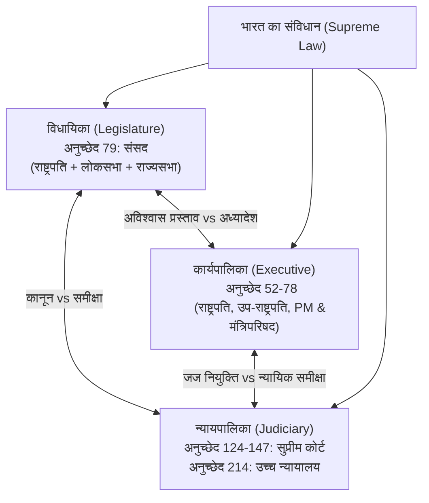
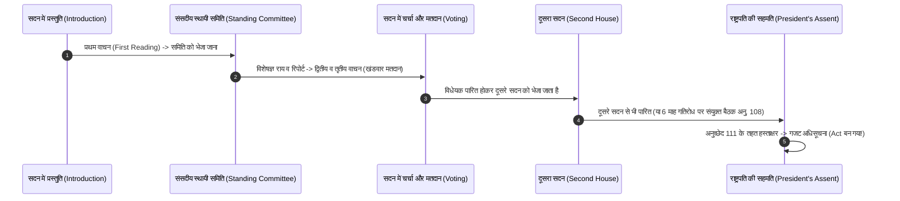

## TL;DR
- **सर्वोच्च विधि:** भारत का संविधान देश का सर्वोच्च कानून (Grundnorm) है, जिसे 26 नवंबर 1949 को अंगीकृत किया गया और 26 जनवरी 1950 को लागू हुआ [1]।
- **तीन स्तंभ (Trias Politica):** सरकार के तीन मुख्य अंग हैं: **विधायिका** (कानून बनाना), **कार्यपालिका** (कानून लागू करना), और **न्यायपालिका** (कानून की व्याख्या करना और संविधान की रक्षा करना)।
- **Checks & Balances:** कोई भी अंग निरंकुश नहीं है। संसद कानून बनाती है, लेकिन सुप्रीम कोर्ट असंवैधानिक कानून को रद्द कर सकता है (Judicial Review) [3]। न्यायपालिका के जजों की नियुक्ति कार्यपालिका/कोलेजियम से होती है, और संसद उन पर महाभियोग (Impeachment) चला सकती है।
- **अर्ध-संघीय ढांचा (Quasi-Federal):** संविधान में संघीय (Federal) विशेषताएं हैं लेकिन केंद्र की ओर झुकाव (Unitary bias) है (7वीं अनुसूची: संघ सूची, राज्य सूची, समवर्ती सूची) [1]।

---

## Why It Matters
एक जागरूक नागरिक और प्रतियोगी परीक्षाओं के छात्र के लिए संविधान का ज्ञान केवल किताबी विषय नहीं है। यह समझना आवश्यक है कि कानून कैसे बनते हैं, आपके मौलिक अधिकार (Fundamental Rights) क्या हैं, और सरकार के तीनों अंग एक-दूसरे की शक्तियों को कैसे संतुलित रखते हैं। इससे नागरिक चर्चाओं में राजनीतिक पूर्वाग्रह के बजाय संवैधानिक तथ्यों पर बात करने की क्षमता आती है।

---

## Theory & Core Concepts

### 1. प्रस्तावना (Preamble): संविधान की आत्मा
प्रस्तावना संविधान के आदर्शों और लक्ष्यों का संक्षिप्त दर्शन है:
- **घोषणा:** *"हम, भारत के लोग... (We, the People of India...)"* — संप्रभुता जनता में निहित है।
- **प्रकृति:** संप्रभु (Sovereign), समाजवादी (Socialist)*, धर्मनिरपेक्ष/पंथनिरपेक्ष (Secular)*, लोकतांत्रिक (Democratic), गणराज्य (Republic)।
  - *(42वें संविधान संशोधन अधिनियम, 1976 द्वारा 'समाजवादी', 'पंथनिरपेक्ष' और 'अखंडता' शब्द जोड़े गए [1])।
- **उद्देश्य:** न्याय (सामाजिक, आर्थिक, राजनीतिक), स्वतंत्रता, समता और बंधुता।

### 2. सरकार के तीन अंग: कार्य और संरचना

| अंग | प्रमुख संरचना | मुख्य संवैधानिक दायित्व | नियंत्रण तंत्र (Check on it) |
| :--- | :--- | :--- | :--- |
| **विधायिका (Legislature)** | संसद: लोकसभा (543 सदस्य) + राज्यसभा (245 सदस्य) + राष्ट्रपति (अनुच्छेद 79) | कानून निर्माण, बजट पारित करना, सरकार से सवाल पूछना [2] | सुप्रीम कोर्ट द्वारा न्यायिक समीक्षा (Judicial Review); राष्ट्रपति की सहमति |
| **कार्यपालिका (Executive)** | राष्ट्रपति (संवैधानिक प्रमुख), प्रधानमंत्री और मंत्रिपरिषद (वास्तविक प्रमुख - अनु. 74) | कानूनों और नीतियों को ज़मीन पर लागू करना, प्रशासन चलाना | लोकसभा में अविश्वास प्रस्ताव (No-Confidence Motion); PAC ऑडिट |
| **न्यायपालिका (Judiciary)** | सुप्रीम कोर्ट (CJI + 33 जज), 25 उच्च न्यायालय, अधीनस्थ अदालतें (अनु. 124) | संविधान का संरक्षक, विवादों का निपटारा, मौलिक अधिकारों का प्रवर्तन | संसद द्वारा महाभियोग (Impeachment under Art 124(4)); कानून में संशोधन |

### 3. सातवीं अनुसूची और शक्तियों का बंटवारा (Seventh Schedule)
संविधान का अनुच्छेद 246 केंद्र और राज्यों के बीच विधायी शक्तियों को 3 सूचियों में बांटता है [1]:
- **संघ सूची (Union List):** 100 विषय (मूलतः 97) — राष्ट्रीय महत्व के मुद्दे जैसे रक्षा, विदेश नीति, परमाणु ऊर्जा, बैंकिंग, रेलवे।
- **राज्य सूची (State List):** 61 विषय (मूलतः 66) — स्थानीय महत्व जैसे पुलिस, सार्वजनिक स्वास्थ्य, स्वच्छता, कृषि, जेल।
- **समवर्ती सूची (Concurrent List):** 52 विषय (मूलतः 47) — शिक्षा, वन, विवाह, दीवानी कानून (केंद्र और राज्य दोनों कानून बना सकते हैं; टकराव होने पर केंद्रीय कानून मान्य होता है - अनु. 254)।
- **अवशिष्ट शक्तियां (Residuary Powers):** जो विषय तीनों सूचियों में नहीं हैं (जैसे Cyber Law, AI Regulation), उन पर कानून बनाने का अधिकार केवल संसद को है (अनुच्छेद 248)।

### 4. बुनियादी ढांचे का सिद्धांत (Basic Structure Doctrine)
**केशवानंद भारती बनाम केरल राज्य (1973)** के ऐतिहासिक फैसले में सुप्रीम कोर्ट की 13 जजों की संविधान पीठ ने 7-6 के बहुमत से फैसला दिया कि:
- संसद अनुच्छेद 368 के तहत संविधान के किसी भी हिस्से में संशोधन कर सकती है, लेकिन वह संविधान के **"मूल ढांचे" (Basic Structure)** को नष्ट या परिवर्तित नहीं कर सकती [3]।
- मूल ढांचे में शामिल हैं: संविधान की सर्वोच्चता, धर्मनिरपेक्षता, लोकतंत्र, कानून का शासन (Rule of Law), और न्यायपालिका की स्वतंत्रता।

---

## Roadmap: भारतीय राजव्यवस्था को 4 हफ्तों में समझें

| Week | Focus | Key Articles to Read | Study Milestone |
| :--- | :--- | :--- | :--- |
| **Week 1** | Preamble, Citizenship & Fundamental Rights | Art 12-35 (Right to Equality, Freedom, Life Art 21, Remedies Art 32) | Make a summary chart of 6 Fundamental Rights & Writs |
| **Week 2** | DPSP & Fundamental Duties | Art 36-51A (Welfare state ideals & 11 citizen duties) | Compare enforceable rights vs non-justiciable principles |
| **Week 3** | Union Government (Executive & Parliament) | Art 52-123 (President, PM, Council of Ministers, Lawmaking, Ordinances) | Track a live bill passing through Lok Sabha & Rajya Sabha |
| **Week 4** | Judiciary & Centre-State Relations | Art 124-147, 245-263, 7th Schedule | Read summary of Kesavananda Bharati judgment |

---

## Hands-on: संसद में एक विधेयक (Bill) कैसे बनता है कानून?

एक सामान्य विधेयक (Ordinary Bill) के पारित होने का चरणबद्ध क्रम:

---

## Curated Resources

### 🎥 Documentaries & Official Videos
- **[Samvidhaan: The Making of the Constitution of India](https://www.youtube.com/watch?v=0U9KDQn6dU4)** by Shyam Benegal / Rajya Sabha TV (10 Episodes, Hindi, Free) — संविधान सभा की ऐतिहासिक बहसों का प्रामाणिक और तटस्थ चित्रण।
- **[Understanding Parliament of India](https://prsindia.org/)** by PRS Legislative Research — बिलों, बहसों और संसदीय समितियों का विस्तृत विश्लेषण [2]।

### 📄 Official Texts & Reference Books
- **[The Constitution of India Official Text](https://legislative.gov.in/constitution-of-india/)** — भारत सरकार के विधि एवं न्याय मंत्रालय की आधिकारिक वेबसाइट [1]।
- **[Indian Polity](https://www.mheducation.co.in/)** by M. Laxmikanth — प्रतियोगी परीक्षाओं और राजव्यवस्था के अध्ययन की सर्वाधिक स्वीकृत संदर्भ पुस्तक।

---

## Common Mistakes & Myths

| Myth / गलतफहमी | Reality / हकीकत |
| :--- | :--- |
| **"राष्ट्रपति के पास सभी वास्तविक शक्तियां हैं"** | राष्ट्रपति राज्य के संवैधानिक प्रमुख (De Jure Head) हैं, लेकिन अनुच्छेद 74 के तहत वे प्रधानमंत्री की अध्यक्षता वाली मंत्रिपरिषद की सलाह पर ही कार्य करने के लिए बाध्य हैं। |
| **"सुप्रीम कोर्ट संसद से बड़ा है या संसद सुप्रीम कोर्ट से बड़ी है"** | भारत में कोई भी एक संस्था 'सर्वोच्च' नहीं है; केवल **संविधान सर्वोच्च** है। संसद संविधान के दायरे में रहकर कानून बनाती है, और अदालतें संविधान के अनुसार उनकी समीक्षा करती हैं। |
| **"संविधान में 'Federal' (संघीय) शब्द लिखा है"** | संविधान के अनुच्छेद 1 में भारत को *"राज्यों का संघ (Union of States)"* कहा गया है, न कि फेडरेशन। डॉ. बी.आर. अंबेडकर के अनुसार, भारतीय संघ राज्यों के बीच किसी समझौते का परिणाम नहीं है और किसी राज्य को अलग होने का अधिकार नहीं है। |

---

## Frequently Asked Questions (FAQ)

### Q1: अनुच्छेद 32 (Constitutional Remedies) को डॉ. अंबेडकर ने संविधान का हृदय और आत्मा क्यों कहा था?
**Ans:** अधिकारों का कोई मूल्य नहीं अगर उनका उल्लंघन होने पर उपचार न मिले। अनुच्छेद 32 नागरिकों को अपने मौलिक अधिकारों के प्रवर्तन के लिए सीधे सुप्रीम कोर्ट जाने का अधिकार देता है, जिसके तहत सुप्रीम कोर्ट 5 प्रकार की रिट्स (Habeas Corpus, Mandamus, Prohibition, Certiorari, Quo-Warranto) जारी कर सकता है।

### Q2: अध्यादेश (Ordinance) क्या होता है और इसकी सीमा क्या है?
**Ans:** जब संसद का सत्र न चल रहा हो और तात्कालिक आवश्यकता हो, तब राष्ट्रपति अनुच्छेद 123 के तहत अध्यादेश जारी कर सकते हैं। इसकी शक्ति संसद के कानून के बराबर होती है, लेकिन संसद का सत्र शुरू होने के 6 सप्ताह के भीतर इसे संसद द्वारा अनुमोदित कराना अनिवार्य होता है, अन्यथा यह निष्प्रभावी हो जाता है।

---

## Related Topics
- [election-process-evm-vvpat](/knowledge-hub/topics/election-process-evm-vvpat/) — चुनाव आयोग और लोकसभा चुनाव प्रक्रिया।
- [union-budget-rti-dbt](/knowledge-hub/topics/union-budget-rti-dbt/) — संसद में बजट पारित होना और नागरिकों के अधिकार।

---

## Sources & References
- [1] Ministry of Law and Justice, Govt of India (2024). *The Constitution of India (As on May, 2024)*. Legislative Department. [https://legislative.gov.in/constitution-of-india/](https://legislative.gov.in/constitution-of-india/)
- [2] PRS Legislative Research (2024). *Parliament Tracking and Bill Summaries*. [https://prsindia.org/](https://prsindia.org/)
- [3] Supreme Court of India (1973). *Kesavananda Bharati Sripadagalvaru and Ors. v. State of Kerala and Anr.* (1973) 4 SCC 225. [https://main.sci.gov.in/judgment/judis/5069.pdf](https://main.sci.gov.in/judgment/judis/5069.pdf)
- [4] Constituent Assembly Debates (1946-1949). *Official Report*. Lok Sabha Secretariat.
