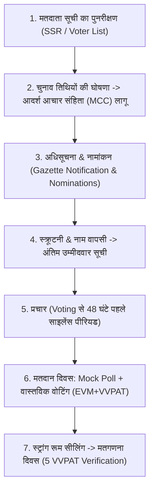
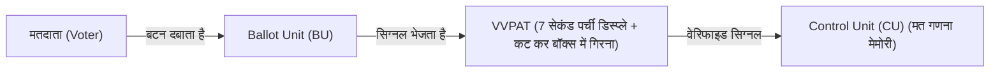

## TL;DR
- **संवैधानिक जनादेश:** संविधान का अनुच्छेद 324 भारत के निर्वाचन आयोग (ECI) को स्वतंत्र, निष्पक्ष चुनाव कराने का पूर्ण अधीक्षण, निर्देशन और नियंत्रण देता है [1]।
- **EVM हार्डवेयर सच्चाई:** भारतीय EVMs (M3 मॉडल) पूरी तरह **स्टैंडअलोन (Standalone)** हैं। इनमें कोई इंटरनेट, वाई-फाई, ब्लूटूथ या वायरलेस रिसीवर नहीं होता। इनका सॉफ्टवेयर केवल निर्माण के समय वन-टाइम प्रोग्रामेबल (OTP) चिप में बर्न किया जाता है [1]।
- **मल्टी-लेयर रैंडमाइजेशन:** चुनाव से पहले दो बार कम्प्यूटरीकृत रैंडमाइजेशन होता है। मतदान के दिन पोलिंग एजेंट्स (सभी पार्टियों के प्रतिनिधियों) की मौजूदगी में कम से कम 50 वोटों का **Mock Poll** कराया जाता है और सर्टिफिकेट साइन होता है।
- **सुप्रीम कोर्ट फैसला (26 अप्रैल 2024):** सुप्रीम कोर्ट (जस्टिस संजीव खन्ना और जस्टिस दीपांकर दत्ता) ने 100% VVPAT पर्चियों की गिनती और बैलेट पेपर पर लौटने की याचिकाएं खारिज कर दीं। साथ ही ECI को निर्देश दिया कि सिंबल लोडिंग यूनिट्स (SLUs) को 45 दिन तक सील रखा जाए और दूसरे/तीसरे नंबर के उम्मीदवारों के अनुरोध पर 5% EVM माइक्रोकंट्रोलर्स की जांच कराई जाए [2]।

---

## Why It Matters
चुनाव लोकतंत्र का महाकुंभ हैं। इंटरनेट पर सोशल मीडिया और व्हाट्सऐप यूनिवर्सिटी में अक्सर बिना तकनीकी समझ के भ्रामक दावे किए जाते हैं। एक शिक्षित नागरिक और इंजीनियर के रूप में यह जानना आवश्यक है कि भारत का चुनावी तंत्र कागजी मतपत्रों से लेकर M3 EVM और VVPAT तक कैसे विकसित हुआ, प्रशासनिक सुरक्षा प्रोटोकॉल क्या हैं, और कानून व न्यायपालिका की क्या भूमिका है।

---

## Theory & Core Concepts

### 1. चुनाव प्रक्रिया का 7-चरणीय चक्र (Lifecycle of an Election)

1. **आदर्श आचार संहिता (Model Code of Conduct - MCC):** ECI द्वारा चुनाव की तारीखों के ऐलान के साथ ही लागू होती है। इसका मकसद सत्ताधारी दल को सरकारी संसाधनों के दुरुपयोग से रोकना और सभी दलों को समान अवसर (Level Playing Field) देना है।
2. **स्क्रूटनी और सिंबल आवंटन:** रिटर्निंग ऑफिसर (RO) नामांकन पत्रों की जांच करते हैं।

---

### 2. EVM और VVPAT की तकनीकी संरचना
भारतीय EVM प्रणाली मुख्य रूप से तीन इकाइयों से मिलकर बनती है [1]:
- **Control Unit (CU):** यह पीठासीन अधिकारी (Presiding Officer) की टेबल पर रहती है। इसमें मुख्य माइक्रोप्रोसेसर और मेमोरी होती है जहाँ कुल वोट दर्ज होते हैं।
- **Ballot Unit (BU):** यह वोटिंग कम्पार्टमेंट के अंदर रहती है जहाँ मतदाता अपनी पसंद के उम्मीदवार का नीला बटन दबाते हैं।
- **VVPAT (Voter Verifiable Paper Audit Trail):** यह BU और CU के बीच जुड़ी होती है। जब वोटर बटन दबाता है, तो VVPAT के पारदर्शी शीशे में 7 सेकंड के लिए एक कागजी पर्ची दिखाई देती है (जिस पर उम्मीदवार का सीरियल नंबर, नाम और चुनाव चिन्ह छपा होता है), और फिर वह पर्ची नीचे सीलबंद बॉक्स में गिर जाती है [4]।

---

### 3. सुरक्षा और पारदर्शिता प्रोटोकॉल: हैकिंग असंभव क्यों है?
- **कोई नेटवर्क कनेक्टिविटी नहीं:** EVMs बैटरी चालित (7.5V पावर पैक) हैं। इनमें सेलुलर, वाई-फाई, ब्लूटूथ या रेडियो फ्रीक्वेंसी का कोई चिप या एंटीना नहीं होता।
- **वन-टाइम प्रोग्रामेबल (OTP):** भारत इलेक्ट्रॉनिक्स लिमिटेड (BEL) और इलेक्ट्रॉनिक्स कॉरपोरेशन ऑफ इंडिया (ECIL) में निर्माण के समय ही कोड बर्न कर दिया जाता है। कोड को बाद में बदला या री-राइट नहीं किया जा सकता [1]।
- **मॉक पोल (Mock Poll):** मतदान शुरू होने से ठीक 90 मिनट पहले, विभिन्न राजनीतिक दलों के पोलिंग एजेंटों के सामने कम से कम 50 वोट डालकर टेस्ट किया जाता है। CU का रिजल्ट और VVPAT की पर्चियों का मिलान किया जाता है, फिर CU को 'Clear' करके सील किया जाता है।

---

### 4. सुप्रीम कोर्ट का लैंडमार्क फैसला (26 अप्रैल 2024)
एसोसिएशन फॉर डेमोक्रेटिक रिफॉर्म्स (ADR) बनाम ECI मामले में सुप्रीम कोर्ट की दो जजों की पीठ ने महत्वपूर्ण निर्णय दिया [2]:
1. **100% VVPAT पर्चियों की गिनती खारिज:** कोर्ट ने माना कि वर्तमान व्यवस्था (प्रत्येक विधानसभा क्षेत्र के 5 यादृच्छिक रूप से चुने गए मतदान केंद्रों की VVPAT पर्चियों का मिलान) सांख्यिकीय दृष्टि से पर्याप्त है। 100% मैनुअल गिनती से मानवीय भूलों की सम्भावना और परिणामों में हफ़्तों की देरी होगी।
2. **बैलेट पेपर पर लौटने से इनकार:** कोर्ट ने मतपत्रों के दौर में बूथ कैप्चरिंग और मतपेटियों में स्याही डालने जैसी ऐतिहासिक बुराइयों का उल्लेख किया।
3. **Symbol Loading Units (SLU) की सीलिंग:** चुनाव के बाद SLUs को उम्मीदवारों के हस्ताक्षर के साथ कम से कम 45 दिन तक स्ट्रांग रूम में सीलबंद रखने का आदेश दिया।
4. **माइक्रोकंट्रोलर सत्यापन का अधिकार:** परिणाम घोषित होने के बाद दूसरे या तीसरे स्थान पर रहे उम्मीदवार लिखित आवेदन देकर संबंधित विधानसभा के 5% EVM के माइक्रोकंट्रोलर की जांच BEL/ECIL के इंजीनियरों से करवा सकते हैं (लागत उम्मीदवार वहन करेगा; यदि विसंगति पाई गई तो शुल्क वापस मिलेगा) [2]।

---

## Roadmap: एक नागरिक के रूप में वोटिंग प्रक्रिया

| Step | Action | Platform / Authority | Important Document |
| :--- | :--- | :--- | :--- |
| **01** | मतदाता सूची में नाम जांचें / नया नाम जोड़ें | Voters' Service Portal (`voters.eci.gov.in`) | फॉर्म 6 (नया मतदाता), फॉर्म 8 (पता संशोधन) |
| **02** | अपना पोलिंग बूथ और भाग संख्या (Part No.) जानें | Voter Helpline App (VHA) | Digital EPIC (ई-वोटर कार्ड) |
| **03** | उम्मीदवारों का आपराधिक रिकॉर्ड और हलफनामा देखें | KYC (Know Your Candidate) App | Affidavit Form 26 |
| **04** | मतदान दिवस पर पहचान सत्यापन | मतदान केंद्र (प्रथम पोलिंग अफसर) | Voter ID / आधार / ड्राइविंग लाइसेंस / पासपोर्ट |
| **05** | अमिट स्याही और मत का प्रयोग | द्वितीय व तृतीय पोलिंग अफसर -> वोटिंग कम्पार्टमेंट | 7 सेकंड VVPAT पर्ची का स्वयं सत्यापन |

---

## Hands-on: Voter Verification Check

आप अपने स्मार्टफोन या कंप्यूटर से ECI के पोर्टल पर अपनी मतदाता प्रविष्टि जांच सकते हैं:
1. `https://electoralsearch.eci.gov.in/` पर जाएं।
2. अपना EPIC (Voter ID No.) या नाम, राज्य व विधानसभा दर्ज करें।
3. परिणाम में अपने पोलिंग स्टेशन का नाम, कमरा नंबर, और सीरियल नंबर नोट कर लें ताकि मतदान के दिन कतार में समय न लगे।

---

## Curated Resources

### 🎥 Videos
- **[How EVMs and VVPATs Work](https://www.youtube.com/watch?v=kYyY8vX0xG0)** by Election Commission of India (10 mins, Hindi, Free) — ECI की आधिकारिक तकनीकी और सुरक्षा प्रक्रियाओं का विवरण।

### 📄 Manuals & Legal Sources
- **[ECI EVM & VVPAT Manual & FAQs](https://www.eci.gov.in/faqs-evm)** — चुनाव आयोग का तकनीकी गाइड [4]।
- **[Supreme Court Judgment Copy (April 2024)](https://main.sci.gov.in/)** — जस्टिस संजीव खन्ना और जस्टिस दीपांकर दत्ता का संपूर्ण फैसला [2]।
- **[Representation of the People Act, 1951](https://legislative.gov.in/actsofparliamentfromtheyear/representation-people-act-1951)** — भारतीय चुनाव का मूल कानूनी ढांचा [3]।

---

## Common Mistakes & Myths

| Myth / गलतफहमी | Reality / हकीकत |
| :--- | :--- |
| **"EVM को मोबाइल या ब्लूटूथ से हैक किया जा सकता है"** | तकनीकी रूप से असंभव। भारतीय EVM में कोई वायरलेस चिप, ब्लूटूथ, वाई-फाई या रेडियो फ्रीक्वेंसी हार्डवेयर मौजूद ही नहीं होता [1]। |
| **"कोई भी बटन दबाने पर वोट किसी एक ही पार्टी को जाता है"** | मॉक पोल में सभी दलों के पोलिंग एजेंट्स स्वयं 50+ वोट डालकर रिजल्ट और VVPAT पर्ची चेक करते हैं। यदि ऐसा कोई भी दोष हो, तो वास्तविक मतदान शुरू होने से पहले ही मशीन बदल दी जाती है। |
| **"VVPAT केवल एक डिस्प्ले स्क्रीन है"** | VVPAT एक थर्मल प्रिंटर युक्त सीलबंद ऑडिट बॉक्स है। पर्ची कटकर सुरक्षित डिब्बे में गिरती है जिसे चुनाव याचिका (Election Petition) की स्थिति में कोर्ट के आदेश पर गिना जा सकता है। |

---

## Frequently Asked Questions (FAQ)

### Q1: NOTA (None of the Above) का कानूनी प्रभाव क्या है?
**Ans:** NOTA का विकल्प मतदाताओं को यह अधिकार देता है कि वे चुनाव मैदान में मौजूद किसी भी उम्मीदवार को वोट न दें। वर्तमान भारतीय चुनावी कानून (First-Past-The-Post) के तहत, यदि NOTA को सबसे ज़्यादा वोट मिलते हैं, तब भी दूसरे स्थान पर रहने वाले उम्मीदवार को ही विजयी घोषित किया जाता है (यद्यपि कई नागरिक संगठन पुनर्मतदान की मांग करते रहे हैं)।

### Q2: यदि किसी मतदाता की VVPAT पर्ची पर गलत चुनाव चिन्ह दिखे तो क्या करें?
**Ans:** चुनाव संचालन नियम 1961 के नियम 49MA के तहत मतदाता पीठासीन अधिकारी से शिकायत कर सकता है। इसके बाद एक टेस्ट वोट (Test Vote) कराया जाता है। यदि दावा सही पाया गया तो मतदान तुरंत रोका जाता है; लेकिन यदि दावा झूठा निकला तो मतदाता के खिलाफ कानूनी कार्रवाई का प्रावधान है।

---

## Related Topics
- [indian-constitution-structure](/knowledge-hub/topics/indian-constitution-structure/) — संविधान का अनुच्छेद 324 और स्वतंत्र संवैधानिक संस्थाएं।
- [union-budget-rti-dbt](/knowledge-hub/topics/union-budget-rti-dbt/) — जन कल्याण और सार्वजनिक जवाबदेही के टूल्स।

---

## Sources & References
- [1] Election Commission of India (2024). *Manual on Electronic Voting Machine and VVPAT (Edition 9)*. [https://www.eci.gov.in/](https://www.eci.gov.in/)
- [2] Supreme Court of India (2024). *Association for Democratic Reforms v. Election Commission of India & Anr.* Writ Petition (Civil) No. 434 of 2023, Judgment dated 26 April 2024. [https://main.sci.gov.in/](https://main.sci.gov.in/)
- [3] Ministry of Law and Justice (1951). *The Representation of the People Act, 1951 (Act No. 43 of 1951)*. [https://legislative.gov.in/actsofparliamentfromtheyear/representation-people-act-1951](https://legislative.gov.in/actsofparliamentfromtheyear/representation-people-act-1951)
- [4] Technical Expert Committee, ECI (2023). *EVM-VVPAT System Architecture and Integrity Reports*.
