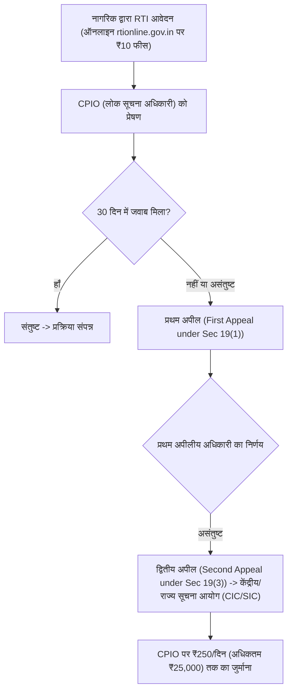

## TL;DR
- **संविधान में 'बजट' शब्द नहीं है:** अनुच्छेद 112 के तहत इसे **"वार्षिक वित्तीय विवरण" (Annual Financial Statement)** कहा जाता है [1]।
- **राजस्व बनाम पूंजीगत खर्च:** Revenue Expenditure दिन-प्रतिदिन के खर्चों (वेतन, पेंशन, सब्सिडी, ब्याज) में जाता है; जबकि **Capital Expenditure (Capex)** से स्थायी संपत्तियां (सड़क, रेलवे, AI इंफ्रा, स्कूल) बनती हैं जो भविष्य की आर्थिक वृद्धि बढ़ाती हैं।
- **राजकोषीय घाटा (Fiscal Deficit):** सरकार का कुल खर्च - कुल गैर-उधार प्राप्तियां। इसे नियंत्रित रखना मुद्रास्फीति (inflation) रोकने के लिए आवश्यक है (FRBM एक्ट के तहत लक्ष्य) [4]।
- **नागरिक टूल्स:** **RTI (2005)** के तहत कोई भी नागरिक ₹10 की फीस देकर 30 दिनों में सरकारी जानकारी पा सकता है [2]। **DBT** (Direct Benefit Transfer) से छात्रवृत्ति और सब्सिडी सीधे आधार-लिंक्ड बैंक खाते में आती है, जिससे बिचौलियों का भ्रष्टाचार खत्म हुआ है [3]।

---

## Why It Matters
जब भी संसद में बजट पेश होता है, टेलीविज़न पर भारी-भरकम शब्दों की बौछार होती है: "कैपेक्स", "फिस्कल डेफिसिट", "डिसइन्वेस्टमेंट"। अधिकांश लोग केवल इनकम टैक्स स्लैब देखकर बजट को छोड़ देते हैं। एक जागरूक युवा और छात्र के लिए यह समझना आवश्यक है कि देश का पैसा कहाँ से आता है (रुपया आता है) और कहाँ जाता है (रुपया जाता है)। साथ ही, RTI और DBT जैसे टूल्स सरकार को जवाबदेह बनाने और अपने कानूनी अधिकार पाने के अचूक हथियार हैं।

---

## Theory & Core Concepts

### 1. बजट की संरचना: रुपया आता कहाँ से है और जाता कहाँ है?
केंद्रीय वित्त मंत्रालय हर साल **"Budget at a Glance"** नामक दस्तावेज़ जारी करता है [1]:

```mermaid
flowchart LR
    subgraph Receipts (पैसा कहाँ से आया)
        R1["उधार और अन्य देयताएं (Borrowings: ~27-28%)"]
        R2["आयकर (Income Tax: ~19%)"]
        R3["जीएसटी (GST & other taxes: ~18%)"]
        R4["कॉर्पोरेट टैक्स (Corporation Tax: ~17%)"]
        R5["गैर-कर राजस्व (Dividends/Fees: ~9%)"]
    end
    subgraph Expenditure (पैसा कहाँ गया)
        E1["ब्याज अदायगी (Interest Payments: ~20%)"]
        E2["राज्यों का हिस्सा (State's share of taxes: ~20%)"]
        E3["केंद्रीय क्षेत्र की योजनाएं (Central Schemes: ~16%)"]
        E4["पूंजीगत व्यय / रक्षा (Capex & Defence: ~14%)"]
        E5["सब्सिडी (खाद्य/उर्वरक: ~6%)"]
        E6["पेंशन व अन्य प्रशासनिक व्यय: ~4%"]
    end
```

### 2. बजट के महत्वपूर्ण आंकड़े और शब्दावली
- **Revenue Deficit (राजस्व घाटा):** जब सरकार की दैनिक आय उसके रोजमर्रा के प्रशासनिक खर्चों से कम हो।
- **Fiscal Deficit (राजकोषीय घाटा):** कुल खर्च - (राजस्व प्राप्तियां + गैर-ऋण पूंजीगत प्राप्तियां)। सरल शब्दों में: सरकार को अपना बजट चलाने के लिए उस साल बाज़ार से कितना उधार लेना पड़ेगा।
- **Primary Deficit (प्राथमिक घाटा):** राजकोषीय घाटा - पिछले कर्ज़ों पर ब्याज अदायगी। यह बताता है कि इस साल की मौजूदा नीतियों के कारण कितना घाटा हुआ है।

---

### 3. RTI Act, 2005: सूचना का अधिकार कैसे इस्तेमाल करें?
नागरिकों को सरकारी कामकाज में पारदर्शिता और जवाबदेही मांगने का कानूनी अधिकार [2]:
- **लागू होने का दायरा:** सभी सार्वजनिक प्राधिकरण (Public Authorities) — केंद्र और राज्य सरकार के विभाग, विश्वविद्यालय, सार्वजनिक बैंक, नगर निगम।
- **फीस:** मात्र ₹10 (BPL कार्डधारकों के लिए पूरी तरह मुफ़्त)।
- **समय सीमा (Section 7(1)):**
  - सामान्य सूचना: **30 दिन** के भीतर।
  - जीवन और व्यक्तिगत स्वतंत्रता (Life & Liberty) से जुड़ा मामला: **48 घंटे** के भीतर।
- **छूट (Section 8):** देश की संप्रभुता, रणनीतिक सुरक्षा, कैबिनेट पेपर्स, या अदालत द्वारा प्रतिबंधित मामलों की सूचना नहीं दी जा सकती।



---

### 4. DBT (Direct Benefit Transfer) और JAM ट्रिनिटी
1 जनवरी 2013 को शुरू की गई DBT प्रणाली ने भारतीय कल्याणकारी योजनाओं की डिलीवरी को पूरी तरह डिजिटल बना दिया है [3]:
- **JAM Trinity:** **J**an Dhan (जीरो बैलेंस बैंक खाता) + **A**adhaar (बायोमेट्रिक पहचान) + **M**obile (SMS अलर्ट और प्रमाणीकरण)।
- **PFMS (सार्वजनिक वित्तीय प्रबंधन प्रणाली):** वित्त मंत्रालय का बैकएंड सिस्टम जो सीधे रिज़र्व बैंक और NPCI के माध्यम से लाभार्थी के बैंक खाते में पैसा क्रेडिट करता है।
- **फायदे:** करोड़ों फर्जी (ghost) राशन कार्ड और छात्रवृत्ति लाभार्थी सिस्टम से बाहर हुए, जिससे सरकारी खजाने के अरबों रुपये की बचत हुई।

---

## Roadmap: 10 मिनट में ऑनलाइन RTI फाइल करना

| Step | Action | Platform | Detail |
| :--- | :--- | :--- | :--- |
| **01** | पोर्टल पर जाएं | `rtionline.gov.in` | 'Submit Request' पर क्लिक करें और दिशानिर्देश स्वीकार करें |
| **02** | मंत्रालय / विभाग चुनें | Dropdown Menu | उदा. Ministry of Railways, UGC, या Ministry of Education |
| **03** | संपर्क जानकारी दर्ज करें | Form Section | नाम, पता, ईमेल, मोबाइल नंबर (SMS अपडेट के लिए) |
| **04** | सटीक प्रश्न लिखें | Text Box (अधिकतम 3,000 अक्षर) | बिंदुवार (Point-wise) और विशिष्ट प्रश्न पूछें; राय न मांगें |
| **05** | ₹10 का भुगतान करें | UPI / Net Banking / Debit Card | BPL आवेदक हों तो BPL सर्टिफिकेट अपलोड करें (फीस 0) |
| **06** | रजिस्ट्रेशन नंबर ट्रैक करें | Track Status Tab | 30 दिन में जवाब न आने पर इसी पोर्टल से 'Submit First Appeal' करें |

---

## Hands-on: RTI आवेदन का आदर्श ड्राफ्ट (Sample Template)

```text
सेवा में,
केंद्रीय लोक सूचना अधिकारी (CPIO),
[संबंधित विभाग / विश्वविद्यालय का नाम], नई दिल्ली।

विषय: सूचना का अधिकार अधिनियम, 2005 के तहत आवेदन।

महोदय/महोदया,
कृपया मुझे निम्नलिखित बिंदुओं पर प्रमाणित सूचना उपलब्ध कराने की कृपा करें:
1. वर्ष 2023-24 और 2024-25 के दौरान [योजना / लैब निर्माण / स्कॉलरशिप मद] में आवंटित कुल बजट की प्रमाणित प्रति।
2. उक्त कार्य के लिए जारी किए गए वर्क ऑर्डर (Work Order) और अंतिम बिल भुगतान की तिथि।
3. संबंधित निर्माण कार्य की गुणवत्ता जांच (Inspection Report) की प्रतिलिपि।

आवेदन शुल्क के रूप में ₹10 का ऑनलाइन भुगतान कर दिया गया है (ट्रांजैक्शन आईडी: XYZ123456)।

भवदीय,
[आपका नाम]
[पता एवं मोबाइल नंबर]
```

---

## Curated Resources

### 📄 Official Portals & Acts
- **[India Budget Official Portal](https://www.indiabudget.gov.in/)** — केंद्रीय बजट के सभी दस्तावेज, भाषण और 'Budget at a Glance' [1]।
- **[RTI Online Portal](https://rtionline.gov.in/)** — केंद्र सरकार के सभी मंत्रालयों और विभागों में RTI फाइल करने का एकल आधिकारिक पोर्टल [2]।
- **[DBT Bharat Official Dashboard](https://dbtbharat.gov.in/)** — 300+ योजनाओं की वास्तविक प्रगति, लाभार्थियों की संख्या और कुल ट्रांसफर आंकड़े [3]।

### 🎥 Explainer Videos
- **[How to Read the Union Budget](https://www.youtube.com/watch?v=Fq_u0G0T5Kk)** by Pranjal Kamra (18 mins, Hindi, Free) — वित्तीय शब्दावली और घाटे का सरल हिंदी विश्लेषण।

---

## Common Mistakes & Myths

| Myth / गलतफहमी | Reality / हकीकत |
| :--- | :--- |
| **"RTI में सरकारी अधिकारी से 'क्यों' (Reasoning) पूछा जा सकता है"** | नहीं। RTI के तहत आप केवल रिकॉर्ड में उपलब्ध जानकारी, फाइल नोटिंग्स, आदेश, या डेटा मांग सकते हैं। आप अधिकारी से उसके निर्णय का 'कारण' या उसकी व्यक्तिगत राय नहीं मांग सकते। |
| **"बजट केवल टैक्स स्लैब का नाम है"** | टैक्स स्लैब केवल फाइनेंस बिल (Finance Bill) का एक हिस्सा है। बजट का मुख्य उद्देश्य देश के आधारभूत ढांचे, स्वास्थ्य, शिक्षा और रक्षा में संसाधनों का राष्ट्रीय आवंटन है। |
| **"DBT का पैसा किसी भी खाते में आ जाता है"** | DBT का पैसा केवल उसी बैंक खाते में क्रेडिट होता है जो **Aadhaar Seeding** के साथ NPCI मैपर (National Payments Corporation of India) पर सक्रिय हो। |

---

## Frequently Asked Questions (FAQ)

### Q1: यदि RTI का जवाब 30 दिनों में न मिले तो क्या करें?
**Ans:** 30 दिन पूरे होते ही आप RTI पोर्टल पर उसी रजिस्ट्रेशन नंबर के साथ **First Appeal** फाइल कर सकते हैं। प्रथम अपीलीय अधिकारी (FAA) विभाग का वरिष्ठ अधिकारी होता है, जिसे 30 से 45 दिनों में मामले का निस्तारण करना अनिवार्य होता है।

### Q2: क्या निजी कॉलेज या कंपनियां RTI के दायरे में आती हैं?
**Ans:** सीधे तौर पर निजी कंपनियां या गैर-सहायता प्राप्त निजी कॉलेज RTI के दायरे में नहीं आते। हालांकि, उन्हें नियंत्रित करने वाले नियामक (जैसे AICTE, UGC, RBI, SEBI) सार्वजनिक प्राधिकरण हैं; आप संबंधित नियामक से उस संस्थान के बारे में जानकारी मांग सकते हैं।

---

## Related Topics
- [indian-constitution-structure](/knowledge-hub/topics/indian-constitution-structure/) — संसद में वित्तीय विधेयकों की मंजूरी और संसदीय समितियां।
- [election-process-evm-vvpat](/knowledge-hub/topics/election-process-evm-vvpat/) — लोकतांत्रिक जवाबदेही और नागरिक सहभागिता।

---

## Sources & References
- [1] Ministry of Finance, Govt of India (2024). *Union Budget: Key to Budget Documents & Budget at a Glance*. [https://www.indiabudget.gov.in/](https://www.indiabudget.gov.in/)
- [2] Department of Personnel and Training (DoPT) (2005). *The Right to Information Act, 2005 (Act No. 22 of 2005)*. [https://rtionline.gov.in/](https://rtionline.gov.in/)
- [3] Direct Benefit Transfer Mission, Cabinet Secretariat (2024). *DBT Progress & State Beneficiary Statistics*. [https://dbtbharat.gov.in/](https://dbtbharat.gov.in/)
- [4] Ministry of Finance (2003). *Fiscal Responsibility and Budget Management (FRBM) Act, 2003*.
