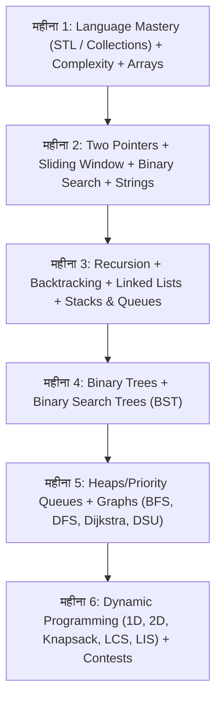

## TL;DR
- **भाषा का चुनाव:** केवल एक भाषा चुनें — **C++** (STL के कारण सबसे लोकप्रिय) या **Java** (Enterprise कंपनियों में प्रिय) या **Python** (syntax आसान, लेकिन recursion depth का ध्यान रखें)। भाषा बदलने में समय बर्बाद न करें।
- **Time & Space Complexity:** कोड लिखने से पहले Big-O ($O(1), O(\log N), O(N), O(N \log N), O(N^2)$) निकालना सीखें। अगर सवाल में $N \le 10^5$ है, तो $O(N \log N)$ या $O(N)$ समाधान ही TLE (Time Limit Exceeded) से बचाएगा।
- **क्वांटिटी नहीं, पैटर्न पहचानें:** 800 सवाल रटने के बजाय NeetCode 150 या Striver A2Z के **15 मुख्य पैटर्न्स** (Two Pointers, Sliding Window, Fast & Slow Pointers, Monotonic Stack, BFS/DFS, Top-Down DP) समझें।
- **मॉक इंटरव्यू व टाइमर:** हर सवाल को 25-30 मिनट के स्टॉपवॉच के साथ हल करें; बिना देखे IDE पर कोड लिखें।

---

## Why It Matters
प्रोडक्ट कंपनियों (Google, Microsoft, Amazon, Atlassian, Adobe) और भारतीय यूनिकॉर्न्स (Swiggy, Zomato, Flipkart) के शुरुआती ऑनलाइन असेसमेंट (OA) और 2-3 राउंड्स पूरी तरह DSA पर आधारित होते हैं। यदि आपका DSA मजबूत नहीं है, तो बेहतरीन प्रोजेक्ट्स होने के बावजूद आप इंटरव्यू राउंड्स तक नहीं पहुँच पाते। 6 महीने का अनुशासित अभ्यास किसी भी छात्र को 0 से Tier-1/Tier-2 पैकेज तक ले जा सकता है।

---

## Theory & Core Concepts

### 1. The Big-O Constraint Matrix (इंटरव्यू में सबसे काम की चीज़)
जब आप सवाल पढ़ें, तो दिए गए इनपुट साइज़ ($N$) को देखकर तुरंत पहचानें कि कौन सा अल्गोरिदम चलेगा:

| Input Size ($N$) | Allowed Time Complexity | Expected Algorithm Pattern |
| :--- | :--- | :--- |
| $N \le 10$ to $20$ | $O(2^N)$ or $O(N!)$ | Backtracking, Recursion, Bitmask DP |
| $N \le 10^3$ | $O(N^2)$ | Nested loops, 2D Dynamic Programming |
| $N \le 10^5$ to $10^6$ | $O(N \log N)$ or $O(N)$ | Binary Search, Sorting, Sliding Window, Heap, Hash Map |
| $N \le 10^9$ to $10^{18}$ | $O(\log N)$ or $O(1)$ | Mathematical formula, Binary Search on Answer, Matrix Exponentiation |

---

### 2. 6-महीने का ब्रेकडाउन (Month-by-Month Roadmap)



#### महीना 1: भाषा, STL और Arrays
- **C++:** `std::vector`, `std::unordered_map`, `std::set`, `std::pair`, Iterators।
- **Arrays Basic:** Kadane's Algorithm (Max Subarray Sum), Dutch National Flag (Sort 0s, 1s, 2s), Majority Element (> N/2).
- **लक्ष्य:** 40 Easy-Medium सवाल हल करना।

#### महीना 2: Two Pointers, Sliding Window और Binary Search
- **Two Pointers:** 3Sum, Container with Most Water, Trapping Rainwater।
- **Sliding Window:** Longest Substring Without Repeating Characters, Minimum Window Substring।
- **Binary Search:** Search in Rotated Sorted Array, Find Minimum, **Binary Search on Answer** (Koko Eating Bananas, Aggressive Cows, Book Allocation).

#### महीना 3: Recursion, Linked Lists, Stacks & Queues
- **Recursion/Backtracking:** Subsets, Permutations, N-Queens, Combination Sum।
- **Linked Lists:** Fast & Slow pointers (Floyd's Cycle detection), Reverse LL, Merge K Sorted Lists।
- **Stacks & Queues:** Monotonic Stack (Next Greater Element I & II, Daily Temperatures, Largest Rectangle in Histogram).

#### महीना 4: Trees & Binary Search Trees (BST)
- **Traversals:** Inorder, Preorder, Postorder (दोनों Recursive और Iterative), Level-order (BFS)।
- **Tree Views:** Top View, Bottom View, Left View, Boundary Traversal।
- **Medium-Hard:** Lowest Common Ancestor (LCA), Maximum Path Sum, Diameter of Tree, Serialize & Deserialize Binary Tree.

#### महीना 5: Heaps और Graphs
- **Heaps:** Top K Frequent Elements, Kth Largest Element, Find Median from Data Stream (Two Heaps pattern)।
- **Graphs:** BFS, DFS, Cycle Detection in Directed/Undirected graphs, Topological Sort (Kahn's Algorithm), Shortest Path (Dijkstra), Disjoint Set Union (DSU/Kruskal's).

#### महीना 6: Dynamic Programming & Contests
- **DP Patterns:** 1D DP (Climbing Stairs, House Robber), 2D Grid DP (Unique Paths), Subsets/Knapsack (0/1 Knapsack, Coin Change), String DP (LCS, Edit Distance), LIS ($O(N \log N)$ with Binary Search)।
- **Weekly Contests:** LeetCode Weekly Contest (शनिवार रात 8:00 या रविवार सुबह 8:00) में भाग लें और 90 मिनट में 2-3 सवाल हल करने की आदत डालें।

---

## Hands-on: Sliding Window Pattern (Gold Standard)

"Find length of longest substring without repeating characters" (LeetCode 3):

```python
def lengthOfLongestSubstring(s: str) -> int:
    char_map = {}  # stores character -> last seen index
    left = 0
    max_len = 0
    
    for right in range(len(s)):
        char = s[right]
        # If character is already in window, jump left pointer
        if char in char_map and char_map[char] >= left:
            left = char_map[char] + 1
        
        char_map[char] = right
        max_len = max(max_len, right - left + 1)
        
    return max_len

# Time Complexity: O(N) single pass
# Space Complexity: O(min(N, 26)) = O(1) auxiliary space
print(lengthOfLongestSubstring("abcabcbb"))  # Output: 3 ("abc")
```

---

## Curated Resources

### 🎥 Playlists & Sheets
- **[Striver's A2Z DSA Sheet](https://takeuforward.org/strivers-a2z-dsa-course/strivers-a2z-dsa-course-sheet-2/)** by Raj Vikramaditya (Hindi/English, Free) — भारत का सबसे संपूर्ण और व्यवस्थित 450+ सवालों का पाथवे [1]।
- **[NeetCode 150](https://neetcode.io/practice)** by Navdeep Singh (English, Free) — पैटर्न-आधारित 150 सबसे महत्वपूर्ण सवाल वीडियो समाधान के साथ [2]।

### 📄 Practice Platforms
- **[LeetCode Explore Cards](https://leetcode.com/explore/)** — Recursion, Binary Search और DP पर कंपनी-वाइज़ सवाल [4]।
- **[Codeforces](https://codeforces.com/)** — स्पीड और प्रॉब्लम सॉल्विंग थिंकिंग को तेज़ करने के लिए (Div 3/Div 4 contests)।

---

## Common Mistakes & Myths

| Myth / गलतफहमी | Reality / हकीकत |
| :--- | :--- |
| **"सवालों की संख्या (जैसे 500+) मायने रखती है"** | अगर आपने 500 सवाल सिर्फ सलूशन देखकर रटे हैं, तो नए सवाल पर आप अटक जाएंगे। 150-200 सवालों को बिना सलूशन देखे खुद सोचना और Dry Run करना कहीं बेहतर है। |
| **"हर 2 हफ्ते में भाषा बदलें"** | कभी C++ तो कभी Java तो कभी Python में स्विच करने वाले छात्र हमेशा बुनियादी syntax में ही फंसे रहते हैं। एक भाषा में महारत हासिल करें। |
| **"सीधे Dynamic Programming से शुरुआत करें"** | DP को समझने के लिए Recursion और Trees की गहरी समझ अनिवार्य है। हमेशा क्रम (Arrays -> Linked Lists -> Trees -> Graphs -> DP) का पालन करें। |

---

## Frequently Asked Questions (FAQ)

### Q1: जब सवाल में 30 मिनट तक कोई विचार न आए तो क्या करें?
**Ans:** 30 मिनट से ज़्यादा समय तक सिर न फोड़ें। (1) सवाल की Constraints दोबारा देखें, (2) छोटे उदाहरण पर पेन-कागज़ पर Dry-Run करें, (3) अगर फिर भी न हो, तो केवल **पहला Hint** पढ़ें। पूरा सलूशन देखने के बाद कोड को तुरंत बंद करें और बिना देखे अपने शब्दों में लिखें। 2 दिन बाद उसी सवाल को दोबारा हल करें।

### Q2: क्या Tier-3 कॉलेज के छात्रों के लिए DSA पर्याप्त है?
**Ans:** नहीं, DSA पहला फ़िल्टर (OA और Tech rounds) है। इसके साथ आपके पास **2 अच्छे फुल-स्टैक या सिस्टम प्रोजेक्ट्स** (देखें [project-ideas-hub](/knowledge-hub/topics/project-ideas-hub/)) और **Core CS** (OS, DBMS, CN) की ठोस तैयारी होनी चाहिए।

---

## Related Topics
- [placement-offcampus-playbook](/knowledge-hub/topics/placement-offcampus-playbook/) — Resume, ATS, Referral और Mock Interview की संपूर्ण रणनीति।
- [core-cs-subjects-interview](/knowledge-hub/topics/core-cs-subjects-interview/) — OS, DBMS और Computer Networks के इंटरव्यू सवाल।

---

## Sources & References
- [1] TakeUForward (2024). *Striver's A2Z DSA Course: Step by Step Preparation*. [https://takeuforward.org/](https://takeuforward.org/)
- [2] NeetCode (2024). *NeetCode 150 Practice Roadmap*. [https://neetcode.io/practice](https://neetcode.io/practice)
- [3] Cormen, T. H., Leiserson, C. E., Rivest, R. L., & Stein, C. (2022). *Introduction to Algorithms (4th ed.)*. MIT Press. [https://mitpress.mit.edu/9780262046305/introduction-to-algorithms/](https://mitpress.mit.edu/9780262046305/introduction-to-algorithms/)
- [4] LeetCode (2024). *Top Interview 150 & Algorithms Study Plan*. [https://leetcode.com/](https://leetcode.com/)
