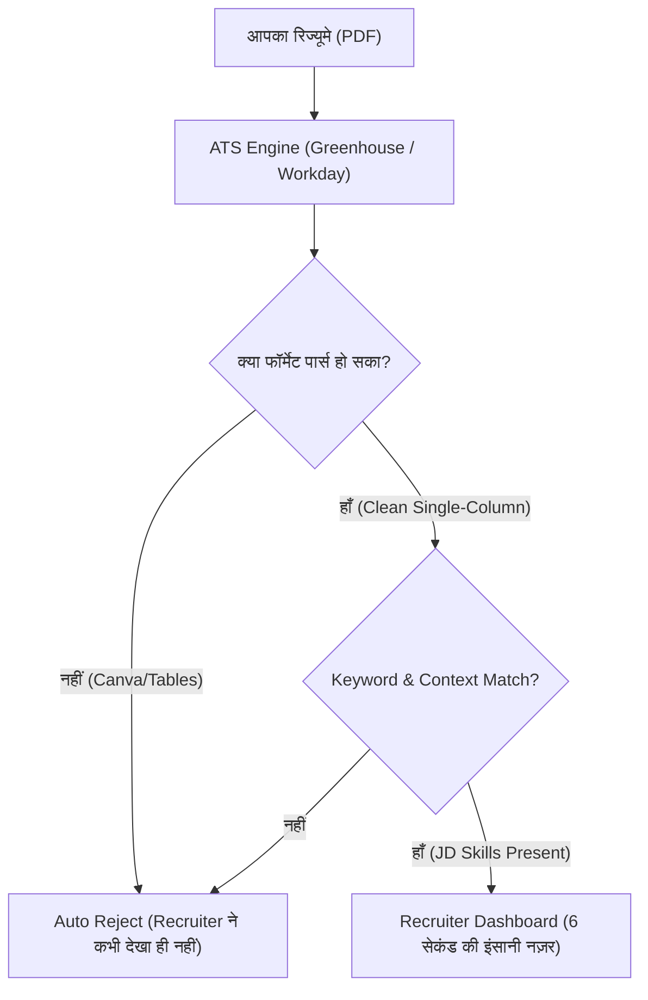

## TL;DR
- **1-Page Strict Rule:** फ्रेशर्स और 0-3 साल के अनुभव वालों का रिज्यूमे हमेशा **1 पेज** का होना चाहिए। दो कॉलम (two-column) या फैंसी कैनवा (Canva) ग्राफ़िक्स वाले टेम्पलेट्स ATS बॉट्स द्वारा रिजेक्ट हो जाते हैं [1]।
- **Google का XYZ फॉर्मूला:** रिज्यूमे के हर बुलेट में लिखें: *"Accomplished [X], as measured by [Y], by doing [Z]"* [3]। साधारण वाक्य *"Created an e-commerce website"* लिखने से शॉर्टलिस्टिंग नहीं होती।
- **GitHub & Live Demos:** प्रोजेक्ट केवल कोड नहीं होना चाहिए; हर प्रोजेक्ट का एक क्लिक पर चलने वाला **Live URL** (Vercel/Render) और सुंदर README (GIFs/screenshots) होना चाहिए।
- **Cold InMail का सच:** बिना किसी संदर्भ के *"Sir please give me referral"* भेजने पर 99% लोग इग्नोर करते हैं। 3-लाइन का कस्टमाइज़्ड पिच और जॉब आईडी भेजने पर 30-40% रिस्पांस रेट मिलता है।

---

## Why It Matters
हजारों योग्य छात्र रात-दिन 400+ LeetCode सवाल हल करते हैं, लेकिन उनका रिज्यूमे कभी इंसानी रिक्रूटर की आंखों तक पहुँचता ही नहीं। ऑफ-कैंपस में एक सिंगल ओपनिंग पर 2,000+ आवेदक होते हैं। ATS (Applicant Tracking System) को पार करना, मजबूत सोशल प्रूफ (GitHub/LinkedIn) बनाना, और सही तरीके से रेफरल हासिल करना ही आपको भीड़ से अलग करके इंटरव्यू रूम में बिठाता है।

---

## Theory & Core Concepts

### 1. ATS (Applicant Tracking System) की कार्यप्रणाली
ATS (जैसे Workday, Taleo, Greenhouse, Lever) कोई जादू नहीं, बल्कि टेक्स्ट पार्सर हैं:
1. **टेक्स्ट एक्सट्रैक्शन:** PDF से हेडिंग्स, स्किल्स, एजुकेशन और प्रोजेक्ट्स का प्लेन टेक्स्ट निकाला जाता है।
2. **कीवर्ड मैचिंग:** जॉब डिस्क्रिप्शन (JD) में लिखे गए कीवर्ड्स (उदा. `TypeScript`, `Docker`, `PostgreSQL`, `REST APIs`) आपके रिज्यूमे में खोजे जाते हैं।
3. **पार्सिंग एरर्स से बचें:** कभी भी टेबल, टेक्स्ट बॉक्स, आइकॉन, प्रोग्रेस बार ("Java: 80%"), या दोहरी कॉलम (multi-column) का इस्तेमाल न करें। **Jake's Resume (Overleaf LaTeX)** वैश्विक मानक है [2]।



---

### 2. Google XYZ Formula से बुलेट्स लिखना
तुलना देखें:
- ❌ **कमज़ोर बुलेट:** *"Built a full-stack chat application using Node.js and MongoDB."* (यह कोई भी बूटकैंप छात्र लिख सकता है)।
- ✅ **Google XYZ बुलेट:** *"Architected a real-time messaging engine supporting 500+ concurrent WebSocket connections, reducing message delivery latency by 35% through Redis Pub/Sub caching."* [3]
  - **[X]:** Real-time messaging engine बनाया।
  - **[Y]:** 500+ concurrent connections, 35% latency कमी।
  - **[Z]:** Node.js WebSockets और Redis Pub/Sub का उपयोग करके।

---

### 3. LinkedIn पर रेफरल मांगने का 3-Step फॉर्मूला
जब आप किसी कंपनी में काम करने वाले इंजीनियर (विशेषकर 1-3 साल सीनियर या कॉलेज एल्युमनाई) से संपर्क करें, तो यह संदेश भेजें:

> *"Hi [Name], I noticed your work on the search infrastructure team at [Company]. I’m a final-year CS undergrad at [College] with production projects in Golang and distributed systems. I found an open role that aligns with my background (Job ID: #123456 - SDE 1). If you have a quick minute, I’d be grateful if you could consider referring my application. Here is my 1-page resume and GitHub: [Links]. Either way, thank you for your time!"*

---

### 4. Behavioral Rounds: The STAR Method
अधिकांश छात्र तकनीकी राउंड निकाल लेते हैं लेकिन Amazon Leadership Principles या HR राउंड में अटक जाते हैं। हर स्थितिजन्य प्रश्न का उत्तर **STAR** में दें:
- **S (Situation):** स्थिति का 2 वाक्यों में संदर्भ ("कॉलेज हैकथॉन में डेडलाइन से 3 घंटे पहले हमारी मुख्य डेटाबेस सर्विस क्रैश हो गई...")।
- **T (Task):** आपकी व्यक्तिगत ज़िम्मेदारी क्या थी ("मुझे 1 घंटे में डेटा लॉस के बिना बैकअप रिस्टोर करना था...")।
- **A (Action):** आपने क्या विशिष्ट कदम उठाए ("मैंने टीम को शांत किया, लॉग्स की जांच की, और रीड-रेप्लिका से डेटा रिकवर किया...")।
- **R (Result):** मापने योग्य परिणाम ("सिस्टम 40 मिनट में लाइव हो गया और हमने हैकथॉन में द्वितीय स्थान प्राप्त किया...")।

---

## Roadmap: 90 Days to Placement-Ready

| Week Span | Focus | Deliverable | Checklist |
| :--- | :--- | :--- | :--- |
| **Weeks 1-2** | Resume Overhaul | Jake's Resume on Overleaf | Single page, 0 formatting errors, XYZ formula bullets [2] |
| **Weeks 3-4** | GitHub Polish | Top 2 Repositories | Add Architecture Diagram, Live Demo Link, Badges, Clean Commits |
| **Weeks 5-6** | LinkedIn Optimization | 500+ Targeted Connections | Headline: "Building High-Scale Systems \| Go & React", 2 weekly technical posts |
| **Weeks 7-8** | Off-Campus Outreach | 100 Job Applications | 30 referral requests + 50 careers portal + 20 Wellfound startups |
| **Weeks 9-12** | Mock Interviews | 10 Technical + 5 Behavioral | Use Pramp for peer coding mocks under 45-min time pressure |

---

## Hands-on: ATS Score Self-Check Script (Python)

यह पाइथन स्क्रिप्ट जांचती है कि आपके रिज्यूमे में JD के कितने ज़रूरी कीवर्ड्स मौजूद हैं:

```python
# Quick keyword overlap checker
def check_ats_overlap(resume_text: str, jd_text: str):
    import re
    # Extract lowercase words
    resume_words = set(re.findall(r'\b[a-zA-Z]{3,}\b', resume_text.lower()))
    jd_words = set(re.findall(r'\b[a-zA-Z]{3,}\b', jd_text.lower()))
    
    # Common tech stop words to skip
    stop_words = {'and', 'the', 'for', 'with', 'you', 'will', 'are', 'have', 'from', 'this', 'that'}
    target_keywords = jd_words - stop_words
    
    matched = target_keywords.intersection(resume_words)
    score = (len(matched) / len(target_keywords)) * 100 if target_keywords else 0
    print(f"Keyword Coverage: {score:.1f}% ({len(matched)} / {len(target_keywords)} terms matched)")
    print("Missing Key Terms:", list(target_keywords - resume_words)[:10])

# Run with your exported resume plain text and target job description
```

---

## Curated Resources

### 📄 Templates & Guides
- **[Jake's Resume LaTeX Template](https://www.overleaf.com/latex/templates/jakes-resume/syzsqbzwxvdx)** — दुनिया का सबसे लोकप्रिय, 100% ATS-कंपैटिबल सिंगल-कॉलम रिज्यूमे टेम्पलेट [2]।
- **[Harvard Career Services Resume Guide](https://careerservices.fas.harvard.edu/resources/create-a-strong-resume/)** — एक्शन वर्ब्स और स्ट्रक्चर का आधिकारिक दस्तावेज़ [1]।

### 🎥 Videos & Platforms
- **[How to Build a SDE Resume that Gets Shortlisted](https://www.youtube.com/watch?v=BYUY1E43R5E)** by Arsh Goyal (Hindi, Free) — भारतीय ऑफ-कैंपस ड्राइव्स और रेफरल रणनीति।
- **[Wellfound (AngelList Talent)](https://wellfound.com/)** — शुरुआती स्टेज के वैश्विक और भारतीय स्टार्टअप्स में सीधे फाउंडर्स और CTOs को अप्लाई करने का बेस्ट प्लेटफॉर्म [4]।

---

## Common Mistakes & Myths

| Myth / गलतफहमी | Reality / हकीकत |
| :--- | :--- |
| **"कैनवा के रंग-बिरंगे 2-कॉलम रिज्यूमे सुंदर दिखते हैं"** | अधिकांश ATS सॉफ्टवेयर मल्टी-कॉलम को बाएं से दाएं एक लाइन में पढ़ लेते हैं, जिससे आपका प्रोजेक्ट और एजुकेशन का टेक्स्ट आपस में उलझ जाता है और स्कोर शून्य हो जाता है। |
| **"1,000 नौकरियों पर 'Easy Apply' क्लिक करना काफी है"** | लिंक्डइन Easy Apply पर 10 मिनट में 2,000 लोग अप्लाई करते हैं। इसके बजाय 50 लक्षित नौकरियों पर रेफरल के ज़रिए अप्लाई करना 10 गुना ज़्यादा इंटरव्यू दिलाता है। |
| **"ऑफ-कैंपस में Tier-3 कॉलेज वालों को कॉल नहीं आता"** | प्रोडक्ट कंपनियां कॉलेज का नाम नहीं, बल्कि आपका GitHub कोड, लाइव डेमो और ऑनलाइन असेसमेंट का स्कोर देखती हैं। |

---

## Frequently Asked Questions (FAQ)

### Q1: क्या मुझे रिज्यूमे में फोटो या पूरा घर का पता डालना चाहिए?
**Ans:** बिल्कुल नहीं। सॉफ्टवेयर इंजीनियरिंग रिज्यूमे में फोटो, वैवाहिक स्थिति, जन्मतिथि या पूरा पता (केवल City, State काफी है) डालने से पूर्वाग्रह (bias) का जोखिम होता है और जगह बर्बाद होती है।

### Q2: यदि मेरे पास कॉलेज में कोई इंटर्नशिप न हो तो क्या लिखूं?
**Ans:** इंटर्नशिप की कमी को **गंभीर पर्सनल प्रोजेक्ट्स** से भरें। 2 ऐसे प्रोजेक्ट्स बनाएं जो लोकलहोस्ट पर न हों, बल्कि लाइव सर्वर पर हों, जिनमें ऑथेंटिकेशन, डेटाबेस, और रियल-टाइम फीचर्स हों। इंटरव्यूअर प्रोजेक्ट की गहराई देखकर इंटर्नशिप की कमी को नज़रअंदाज़ कर देते हैं।

---

## Related Topics
- [dsa-roadmap-6-months](/knowledge-hub/topics/dsa-roadmap-6-months/) — कोडिंग असेसमेंट और एल्गोरिदम राउंड्स की तैयारी।
- [project-ideas-hub](/knowledge-hub/topics/project-ideas-hub/) — रिज्यूमे में शामिल करने लायक टॉप प्रोजेक्ट्स और उनकी वास्तुकला।

---

## Sources & References
- [1] Harvard University FAS Mignone Center for Career Success (2024). *Resumes & Cover Letters: Best Practices*. [https://careerservices.fas.harvard.edu/resources/create-a-strong-resume/](https://careerservices.fas.harvard.edu/resources/create-a-strong-resume/)
- [2] Gutierrez, J. (2024). *Jake's Resume Overleaf Official LaTeX Template*. [https://www.overleaf.com/latex/templates/jakes-resume/syzsqbzwxvdx](https://www.overleaf.com/latex/templates/jakes-resume/syzsqbzwxvdx)
- [3] Google Careers (2024). *Create Your Resume: The Google Formula*. [https://www.google.com/about/careers/applications/how-we-hire/](https://www.google.com/about/careers/applications/how-we-hire/)
- [4] Wellfound (2024). *Startup Hiring & Technical Talent Compensation*. [https://wellfound.com/](https://wellfound.com/)
