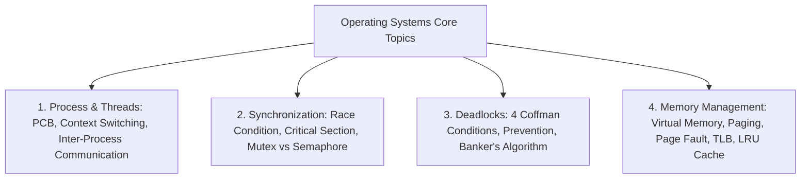

## TL;DR
- **The 80/20 Rule:** पूरी 800-पेज की किताब पढ़ने की ज़रूरत नहीं है। 80% इंटरव्यू सवाल केवल 20% मुख्य विषयों (Virtual Memory, Deadlocks, ACID, Indexing, TCP 3-Way Handshake, DNS flow, SOLID) से पूछे जाते हैं [1, 2, 3]।
- **OS:** Process vs Thread, Mutex vs Semaphore, 4 Coffman conditions for Deadlock, Virtual Memory (Paging, Page Fault, TLB) [1]।
- **DBMS:** ACID properties, Normalization (1NF to BCNF), B+ Tree Indexing (Range queries में hash index से बेहतर क्यों है), Transaction Isolation levels [2]।
- **CN:** OSI 7 Layers vs TCP/IP 4 Layers, TCP 3-Way Handshake, DNS resolution step-by-step, HTTP/1.1 vs HTTP/2 vs HTTP/3 [3]।
- **OOP:** 4 Pillars (Encapsulation, Abstraction, Inheritance, Polymorphism) + 5 **SOLID** principles कोड उदाहरण के साथ।

---

## Why It Matters
अधिकांश छात्र केवल DSA हल करते हैं और इंटरव्यू के दूसरे राउंड में जब इंटरव्यूअर पूछता है: *"जब आप ब्राउज़र में `google.com` टाइप करके Enter दबाते हैं तो पर्दे के पीछे क्या होता है?"* या *"Mutex और Semaphore में क्या अंतर है?"* — तो वे बगले झांकने लगते हैं। Core CS विषय यह साबित करते हैं कि आप सिर्फ कोड रटने वाले नहीं हैं, बल्कि सिस्टम्स कैसे चलते हैं, इसकी गहरी समझ रखते हैं।

---

## Theory & Core Concepts

### 1. Operating Systems (OS): अनिवार्य विषय



- **Process vs Thread:** Process एक स्वतंत्र प्रोग्राम है जिसके पास अपनी अलग मेमोरी स्पेस (Stack, Heap, Data) होती है। Thread एक प्रोसेस के अंदर का 'लाइटवेट' घटक है जो उसी प्रोसेस की मेमोरी स्पेस शेयर करता है।
- **Mutex vs Semaphore:**
  - **Mutex (Mutual Exclusion):** लॉकिंग मैकेनिज्म (केवल 1 चाबी होती है)। जिस थ्रेड ने लॉक लिया, वही अनलॉक कर सकता है।
  - **Counting Semaphore:** सिग्नलिंग मैकेनिज्म। यदि एक समय में 4 थ्रेड्स को संसाधन देना है, तो इनिशियल काउंटर 4 रखा जाता है; `wait()` काउंटर घटाता है और `signal()` बढ़ाता है।
- **Deadlock की 4 Coffman शर्तें [1]:**
  1. *Mutual Exclusion* (संसाधन शेयर नहीं हो सकता)।
  2. *Hold and Wait* (एक संसाधन पकड़कर दूसरे का इंतज़ार करना)।
  3. *No Preemption* (जबर्दस्ती छीना नहीं जा सकता)।
  4. *Circular Wait* ($P_1 \to R_2 \to P_2 \to R_1$).

---

### 2. Database Management Systems (DBMS)

| विषय | इंटरव्यू में क्या पूछा जाता है | मुख्य उत्तर सार |
| :--- | :--- | :--- |
| **ACID Properties** | Transactions की गारंटी | **Atomicity** (All or Nothing), **Consistency** (Valid state to valid state), **Isolation** (Concurrent transactions do not collide), **Durability** (Committed data survives power failure) [2]। |
| **B+ Tree Indexing** | RDBMS में Hash Index के बजाय B+ Tree क्यों? | B+ Tree में सभी data pointers केवल Leaf Nodes पर होते हैं और Leaf Nodes आपस में Doubly Linked List से जुड़े होते हैं, जिससे **Range Queries** ($> 100$ and $< 500$) अत्यंत तीव्र ($O(\log N)$) होती हैं। |
| **Normalization** | Data Redundancy और Anomalies हटाना | **1NF:** Atomic values; **2NF:** No partial dependency on candidate key; **3NF:** No transitive dependency ($A \to B, B \to C$); **BCNF:** For every $X \to Y$, $X$ must be a super key. |
| **SQL Window Functions** | `RANK()` vs `DENSE_RANK()` | अगर दो छात्रों के बराबर अंक हैं: `RANK()` गैप छोड़ता है (1, 2, 2, 4); जबकि `DENSE_RANK()` बिना गैप के चलता है (1, 2, 2, 3)। |

---

### 3. Computer Networks (CN): The Classic Interview Flow
**"जब आप ब्राउज़र में URL डालते हैं तो क्या होता है?"** [3]:
1. **URL Parsing & HSTS Check:** ब्राउज़र प्रोटोकॉल (HTTPS) और डोमेन अलग करता है।
2. **DNS Resolution:** Browser Cache -> OS Cache -> Router Cache -> ISP Resolver -> Root DNS (.) -> TLD DNS (.com) -> Authoritative Nameserver (IP पता लौटाता है)।
3. **TCP 3-Way Handshake:**
   - Client sends `SYN` (Synchronize).
   - Server replies with `SYN-ACK`.
   - Client confirms with `ACK`. (इसके बाद TLS Handshake से SSL सर्टिफिकेट और सिमेट्रिक कीज तय होती हैं)।
4. **HTTP Request & Response:** ब्राउज़र `GET /` भेजता है; सर्वर `200 OK` और HTML/CSS/JS लौटाता है।
5. **DOM Tree & Rendering:** ब्राउज़र HTML पार्स करके DOM बनाता है और स्क्रीन पर रेंडर करता है।

---

### 4. OOP & SOLID Principles

```text
S - Single Responsibility: एक क्लास का केवल एक ही काम (Reason to change) होना चाहिए।
O - Open/Closed: क्लास एक्सटेंशन (नई कार्यक्षमता जोड़ने) के लिए खुली हो, लेकिन संशोधन (मौजूदा कोड बदलने) के लिए बंद हो।
L - Liskov Substitution: सब-क्लास (child) को बिना प्रोग्राम तोड़े पैरेंट-क्लास की जगह इस्तेमाल किया जा सके।
I - Interface Segregation: क्लाइंट को उन मेथड्स पर निर्भर होने के लिए बाध्य न करें जिनकी उसे ज़रूरत नहीं (छोटे इंटरफेस बनाएं)।
D - Dependency Inversion: उच्च-स्तरीय मॉड्यूल निम्न-स्तरीय मॉड्यूल पर निर्भर न हों; दोनों एब्स्ट्रैक्शन (Interfaces) पर निर्भर हों।
```

---

## Roadmap: 4 हफ्तों में Core CS पूरा करें

| Week | Focus Subject | Daily Target (2 Hrs/Day) | Self-Assessment Milestone |
| :--- | :--- | :--- | :--- |
| **Week 1** | Operating Systems | Process Lifecycle, Scheduling, Synchronization, Deadlock, Virtual Memory | Gate Smashers OS Playlist (चुनिंदा 25 वीडियो) [4] |
| **Week 2** | DBMS & SQL | ER Diagrams, ACID, Normalization, B+ Trees, Joins & Indexing | Solve 20 SQL problems on LeetCode Database section |
| **Week 3** | Computer Networks | OSI vs TCP/IP, DNS, TCP Handshake, HTTP/1.1 vs 2 vs 3, Subnetting | Gate Smashers CN Playlist + Explain DNS flow aloud |
| **Week 4** | OOP & SOLID | Encapsulation, Polymorphism, Abstract classes vs Interfaces, SOLID code | Write clean Java/C++ code implementing all 5 SOLID principles |

---

## Hands-on: SOLID Principle Code Example (Single Responsibility & Dependency Inversion)

खराब कोड बनाम स्वच्छ कोड का उदाहरण:

```java
// ❌ BAD: Single class handles payment logic, database save, AND email notification
class OrderService {
    public void processOrder() {
        // payment math...
        // direct SQL queries...
        // SMTP email code...
    }
}

// ✅ GOOD: Decoupled using Dependency Inversion & Single Responsibility
interface PaymentProcessor {
    void pay(double amount);
}

interface NotificationService {
    void sendReceipt(String email);
}

class StripePayment implements PaymentProcessor {
    public void pay(double amount) { /* Stripe API call */ }
}

class EmailService implements NotificationService {
    public void sendReceipt(String email) { /* Sendgrid API */ }
}

class CleanOrderService {
    private final PaymentProcessor payment;
    private final NotificationService notification;

    public CleanOrderService(PaymentProcessor payment, NotificationService notification) {
        this.payment = payment;
        this.notification = notification;
    }

    public void checkout(double amount, String userEmail) {
        payment.pay(amount);
        notification.sendReceipt(userEmail);
    }
}
```

---

## Curated Resources

### 🎥 Playlists (Hindi)
- **[Gate Smashers OS Playlist](https://www.youtube.com/playlist?list=PLxCzCOWd7aiGz9donHRrE9I3Mwn6XdP8p)** by Varun Singla (Hindi, Free) — भारतीय इंजीनियरिंग छात्रों के लिए सबसे लोकप्रिय और परीक्षा-केंद्रित व्याख्यान।
- **[Gate Smashers DBMS Playlist](https://www.youtube.com/playlist?list=PLxCzCOWd7aiFAN6I8CuViBuCdJgiOkT2Y)** — Normalization और SQL का सबसे आसान हिंदी एक्सप्लेनर।
- **[Gate Smashers CN Playlist](https://www.youtube.com/playlist?list=PLxCzCOWd7aiGFBD2-2joCpWOLUrDLvVV_)** — लेयर्स और प्रोटोकॉल्स का संपूर्ण विवरण।

### 📄 Standard Reference Books
- **[Operating System Concepts](https://www.os-book.com/)** by Silberschatz, Galvin & Gagne [1]।
- **[Computer Networking: A Top-Down Approach](https://gaia.cs.umass.edu/kurose_ross/online_lectures.htm)** by Kurose & Ross [3]।

---

## Common Mistakes & Myths

| Myth / गलतफहमी | Reality / हकीकत |
| :--- | :--- |
| **"केवल डेफिनिशन रटने से काम चल जाएगा"** | इंटरव्यूअर किताबी परिभाषाएं नहीं सुनते; वे तुरंत फॉलो-अप पूछते हैं: *"अगर मैं Deadlock में No Preemption हटा दूँ तो क्या होगा?"* या *"B+ Tree की जगह Red-Black Tree क्यों नहीं इस्तेमाल किया?"* |
| **"HTTP और HTTPS में केवल 'S' का अंतर है"** | HTTPS के लिए पोर्ट 443 पर TLS 1.3 हैंडशेक होता है, जिसमें Asymmetric Encryption (RSA/ECC) से Symmetric Key (AES-256) का आदान-प्रदान किया जाता है। |
| **"NoSQL RDBMS से हमेशा बेहतर होता है"** | NoSQL (MongoDB, Cassandra) हॉरिजॉन्टल स्केलिंग और अनस्ट्रक्चर्ड डेटा के लिए अच्छा है, लेकिन जहां सख्त ट्रांजैक्शनल इंटीग्रिटी (बैंकिंग) चाहिए, वहां RDBMS ACIDिटी अनिवार्य है। |

---

## Frequently Asked Questions (FAQ)

### Q1: Thrashing क्या होता है?
**Ans:** जब ऑपरेटिंग सिस्टम का CPU वास्तविक काम करने के बजाय सारा समय केवल पेजों को रैम और हार्ड डिस्क के बीच स्वैप (Swap in / Swap out) करने में बिताता है, तो सिस्टम की परफॉरमेंस लगभग शून्य हो जाती है। इसे **Thrashing** कहते हैं।

### Q2: TCP और UDP में मुख्य अंतर क्या है?
**Ans:** **TCP** कनेक्शन-ओरिएंटेड है, डेटा पैकेट के सही क्रम में सुरक्षित पहुँचने की गारंटी (ACK) देता है (वेबसाइट्स, ईमेल, फाइल ट्रांसफर के लिए)। **UDP** कनेक्शन-रहित है, कोई गारंटी नहीं देता लेकिन बहुत तेज़ और लो-लेटेंसी होता है (वीडियो स्ट्रीमिंग, लाइव गेमिंग, VoIP के लिए)।

---

## Related Topics
- [dsa-roadmap-6-months](/knowledge-hub/topics/dsa-roadmap-6-months/) — कोडिंग और अल्गोरिदम इंटरव्यू की तैयारी।
- [placement-offcampus-playbook](/knowledge-hub/topics/placement-offcampus-playbook/) — तकनीकी इंटरव्यू राउंड्स और मॉक सेशंस।

---

## Sources & References
- [1] Silberschatz, A., Galvin, P. B., & Gagne, G. (2018). *Operating System Concepts (10th ed.)*. John Wiley & Sons. [https://www.os-book.com/](https://www.os-book.com/)
- [2] Ramakrishnan, R., & Gehrke, J. (2002). *Database Management Systems (3rd ed.)*. McGraw-Hill. [https://pages.cs.wisc.edu/~dbbook/](https://pages.cs.wisc.edu/~dbbook/)
- [3] Kurose, J. F., & Ross, K. W. (2021). *Computer Networking: A Top-Down Approach (8th ed.)*. Pearson. [https://gaia.cs.umass.edu/kurose_ross/online_lectures.htm](https://gaia.cs.umass.edu/kurose_ross/online_lectures.htm)
- [4] Gate Smashers (2024). *Varun Singla Engineering Education Series*. [https://www.youtube.com/@GateSmashers](https://www.youtube.com/@GateSmashers)
