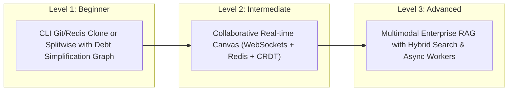
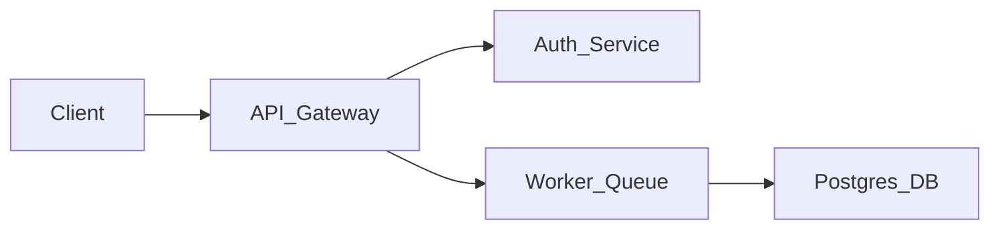

## TL;DR
- **"To-Do App" और "Weather App" अब बंद करें:** रिक्रूटर्स हर दिन सैकड़ों एक जैसे क्लोन प्रोजेक्ट्स देखते हैं। अगर आपका प्रोजेक्ट YouTube के किसी 2 घंटे के ट्यूटोरियल की हूबहू कॉपी है, तो वह आपके रिज्यूमे को नुकसान पहुँचाता है।
- **तीनों स्तरों का संतुलन:** आपके रिज्यूमे में कम से कम 2 से 3 ठोस प्रोजेक्ट्स होने चाहिए: एक गहरा **Full-Stack / Systems** प्रोजेक्ट और एक **AI/ML या Cloud-Native** प्रोजेक्ट।
- **हर प्रोजेक्ट में क्या होना चाहिए:** (1) वास्तविक प्रॉब्लम स्टेटमेंट, (2) आर्किटेक्चर डायग्राम, (3) लाइव डेप्लॉयड लिंक, (4) सांख्यिकीय मैट्रिक्स (Latency, Concurrency, Users) [2]।
- **Google XYZ फॉर्मूला:** प्रोजेक्ट्स को रिज्यूमे में *"Accomplished [X] as measured by [Y], by doing [Z]"* रूप में लिखें।

---

## Why It Matters
जब आप ऑफ-कैंपस अप्लाई करते हैं या किसी टेक इंटरव्यूअर के सामने बैठते हैं, तो इंटरव्यू का 60% समय आपके प्रोजेक्ट्स पर चर्चा में बीतता है। एक मजबूत प्रोजेक्ट यह दिखाता है कि आप केवल LeetCode पर सवाल हल करना नहीं जानते, बल्कि आपको वास्तविक दुनिया में एरर हैंडलिंग, डेटाबेस स्केलिंग, सुरक्षा, और डेप्लॉयमेंट का व्यावहारिक अनुभव है।

---

## Theory & Core Concepts: The Project Spectrum



---

## The Curated Projects Catalogue

### 1. Beginner Project: Smart Expense Splitter with Graph Debt Simplification
- **Domain:** Data Structures & Algorithms + Web Dev
- **Problem Statement:** दोस्तों के ग्रुप में बिल बांटते समय 20 अलग-अलग लेन-देन बन जाते हैं। न्यूनतम संभव बैंक ट्रांजैक्शंस में सबका हिसाब चुकता करना।
- **Tech Stack:** Node.js / Express, React, PostgreSQL / SQLite.
- **Core Engineering:** Greedy / Min-Flow **Graph Simplification Algorithm** का कार्यान्वयन (Splitwise का कोर एल्गोरिदम)।
- **Resume Framing (Google XYZ):**
  > *"Engineered a debt-settlement web engine implementing a greedy min-cash-flow graph algorithm, reducing multi-party inter-group transactions by 65% across 200+ simulated users."*

---

### 2. Intermediate Project: Real-Time Collaborative Document Editor
- **Domain:** Distributed Systems + Full Stack
- **Problem Statement:** Google Docs या Notion की तरह कई यूजर्स एक ही दस्तावेज़ को एक साथ बिना डेटा टकराव (merge conflicts) के एडिट कर सकें।
- **Tech Stack:** Go या Node.js, WebSockets, React, Redis Pub/Sub, **CRDT (Conflict-free Replicated Data Types)** या Yjs [1]।
- **Architecture Highlights:**
  - Client A और Client B दोनों ऑफलाइन या खराब नेटवर्क पर भी टाइप कर सकते हैं।
  - Redis Pub/Sub द्वारा कई सर्वर इंस्टैंसेस में ऑपरेशनल स्टेट सिंक होती है।
  - JWT आधारित रोल-बेस्ड एक्सेस कंट्रोल (Viewer, Editor, Owner)।
- **Resume Framing (Google XYZ):**
  > *"Architected a real-time collaborative Markdown editor using WebSockets and CRDTs, synchronizing document state across 500+ concurrent clients with sub-50ms peer-to-peer reconciliation latency."*

---

### 3. Advanced Project: Enterprise RAG Knowledge Platform with Hybrid Search
- **Domain:** Applied AI & GenAI + Cloud Native
- **Problem Statement:** किसी संगठन के हज़ारों आंतरिक PDFs, Notion डॉक्स और कोड रिपॉजिटरीज़ पर तथ्यपरक और बिना Hallucination के प्रश्न-उत्तर प्रणाली बनाना।
- **Tech Stack:** Python, FastAPI, LangChain, Qdrant / Milvus (Vector DB), BM25 Sparse Search, Docker, AWS EC2 / Render.
- **Architecture Highlights:**
  - **Hybrid Search:** Dense Embeddings (सटीक अर्थ) + BM25 (सटीक कीवर्ड्स) को **Reciprocal Rank Fusion (RRF)** से जोड़ना।
  - **Reranker:** Cohere Rerank मॉडल से टॉप 5 सबसे प्रासंगिक चंक्स निकालना।
  - **Asynchronous Task Queue:** Celery + Redis से बड़े 100-पेज के PDFs को बैकग्राउंड में पार्स करना ताकि API ब्लॉक न हो।
- **Resume Framing (Google XYZ):**
  > *"Built an enterprise semantic search and RAG engine handling 10,000+ technical documents, cutting hallucinations by 40% and boosting recall to 91% using hybrid vector-BM25 retrieval and asynchronous Celery workers."*

---

### 4. Advanced Systems Project: Distributed Token-Bucket Rate Limiter & Reverse Proxy
- **Domain:** Backend, Systems, Networking
- **Problem Statement:** माइक्रोसर्विसेज आर्किटेक्चर में DDoS हमलों को रोकना और API एंडपॉइंट्स पर कस्टम थ्रॉटलिंग लागू करना।
- **Tech Stack:** Go (Golang), Redis (Lua Scripts), Docker.
- **Architecture Highlights:**
  - Sliding Window Counter और Token Bucket एल्गोरिदम।
  - Redis में एटॉमिक लुआ स्क्रिप्ट्स ताकि रेस कंडीशंस से बचा जा सके।
  - Prometheus और Grafana मैट्रिक्स एक्सपोर्टर (429 Too Many Requests ट्रैकिंग)।
- **Resume Framing (Google XYZ):**
  > *"Implemented a distributed API gateway rate limiter in Go utilizing Redis atomic Lua scripts, throttling 10,000+ RPS with sub-3ms middleware overhead and automated Prometheus observability."*

---

## Roadmap: 6 हफ्तों में एक शोकेस प्रोजेक्ट तैयार करें

| Week | Phase | Actions & Milestones |
| :--- | :--- | :--- |
| **Week 1** | Requirement & Architecture | README ड्राफ्ट करें, Architecture Diagram (Mermaid) बनाएं, DB Schema फाइनल करें |
| **Week 2** | Core Backend & APIs | डेटाबेस माइग्रेशन, CRUD एंडपॉइंट्स, Unit Tests, ऑथेंटिकेशन (JWT) |
| **Week 3** | Frontend & UX | रिस्पॉन्सिव यूआई (Tailwind), लोडिंग स्टेट्स, टोस्ट एरर नोटिफिकेशन्स |
| **Week 4** | Advanced Feature Layer | रियल-टाइम WebSockets, Vector Search, या Caching लेयर जोड़ें |
| **Week 5** | Containerization & Deployment | Dockerfile लिखें, Render / AWS / Vercel पर लाइव डेप्लॉय करें, कस्टम डोमेन जोड़ें |
| **Week 6** | Portfolio Presentation | 2-मिनट का Loom वीडियो डेमो बनाएं, GitHub README में आर्किटेक्चर और GIFs लगाएं |

---

## Hands-on: Clean GitHub README Template

अपने प्रोजेक्ट के GitHub रिपॉजिटरी में यह स्ट्रक्चर रखें:

```markdown
# 🚀 Project Name (Catchy Title)

> One-sentence elevator pitch of what this solves.

[](https://your-demo-url.com)
[](https://opensource.org/licenses/MIT)

## 📌 Problem & Solution
Explain the business or engineering problem in 3 lines, and how your solution tackles it.

## 🏗️ System Architecture


## ✨ Key Features
- Feature 1: Low-latency caching using Redis
- Feature 2: Role-based Access Control (RBAC) with JWT
- Feature 3: Full-text hybrid search with BM25 & Qdrant

## ⚡ Quickstart (Local Run)
```bash
git clone https://github.com/username/project.git
cd project && docker-compose up --build
```
```

---

## Curated Resources

### 📄 Architecture References
- **[System Design Primer](https://github.com/donnemartin/system-design-primer)** by Donne Martin (GitHub, Free) — वास्तविक दुनिया के आर्किटेक्चर पैटर्न और स्केलिंग [1]।
- **[Build Your Own X](https://github.com/codecrafters-io/build-your-own-x)** — Redis, Docker, Git, OS स्क्रैच से बनाने की चरणबद्ध गाइड्स [3]।

### 🎥 Tutorials & Guidance
- **[freeCodeCamp Full-Stack Projects](https://www.freecodecamp.org/)** — प्रोडक्शन-ग्रेड प्रोजेक्ट्स के मुफ़्त ट्यूटोरियल्स और कोड बेस [4]।

---

## Common Mistakes & Myths

| Myth / गलतफहमी | Reality / हकीकत |
| :--- | :--- |
| **"जितना बड़ा टेक स्टैक, उतना बेहतर प्रोजेक्ट"** | एक ही प्रोजेक्ट में बिना ज़रूरत के Next.js, Django, Rust, Kafka, और Kubernetes सब कुछ डालना 'Resume Buffing' कहलाता है। इंटरव्यूअर तुरंत समझ जाते हैं कि आपने कोड कॉपी किया है। |
| **"GitHub पर 50 छोटे रिपॉजिटरीज़ होने चाहिए"** | 50 अधूरे ट्यूटोरियल रिपॉजिटरीज़ के बजाय **2 से 3 परिष्कृत, स्टार-रेटेड, वेल-डॉक्यूमेंटेड प्रोजेक्ट्स** होना 100 गुना अधिक प्रभावी होता है। |
| **"लोकलहोस्ट पर चलना काफी है"** | अगर कोई रिक्रूटर आपके प्रोजेक्ट का लाइव लिंक नहीं खोल सकता, तो वह कोड क्लोन करके नहीं देखेगा। हमेशा Vercel/Render/Fly.io पर लाइव डेप्लॉय करें। |

---

## Frequently Asked Questions (FAQ)

### Q1: मुझे प्रोजेक्ट के लिए यूनिक आइडिया कैसे मिलेगा?
**Ans:** अपने या अपने कॉलेज/लोकल कम्युनिटी की असली परेशानी को देखें: कॉलेज का लैब रूम बुकिंग सिस्टम, हॉस्टल मेस फीडबैक ट्रैकर, या ओपन-सोर्स टूल्स के बीच गैप। असली उपयोगकर्ताओं की समस्या हल करने वाले प्रोजेक्ट्स हमेशा सबसे ज़्यादा प्रभावित करते हैं।

### Q2: क्या कॉलेज प्रोजेक्ट में ग्रुप प्रोजेक्ट लिखना ठीक है?
**Ans:** हाँ, लेकिन रिज्यूमे में साफ़ लिखें कि **आपकी व्यक्तिगत भूमिका क्या थी** (उदा. *"Owned the backend microservices, caching layer, and database architecture in a 4-person team"*).

---

## Related Topics
- [placement-offcampus-playbook](/knowledge-hub/topics/placement-offcampus-playbook/) — प्रोजेक्ट्स को रिज्यूमे और लिंक्डइन पर कैसे शोकेस करें।
- [ai-agents-and-rag](/knowledge-hub/topics/ai-agents-and-rag/) — मॉडर्न AI/ML प्रोजेक्ट्स की वास्तुकला।

---

## Sources & References
- [1] Martin, D. (2024). *The System Design Primer*. GitHub Repository. [https://github.com/donnemartin/system-design-primer](https://github.com/donnemartin/system-design-primer)
- [2] Google Careers (2024). *How to Create a Great Technical Resume (The XYZ Impact Formula)*. [https://www.google.com/about/careers/applications/how-we-hire/](https://www.google.com/about/careers/applications/how-we-hire/)
- [3] CodeCrafters (2024). *Build Your Own X*. [https://github.com/codecrafters-io/build-your-own-x](https://github.com/codecrafters-io/build-your-own-x)
- [4] freeCodeCamp (2024). *Open Source Real-World Project Curriculum*. [https://www.freecodecamp.org/](https://www.freecodecamp.org/)
